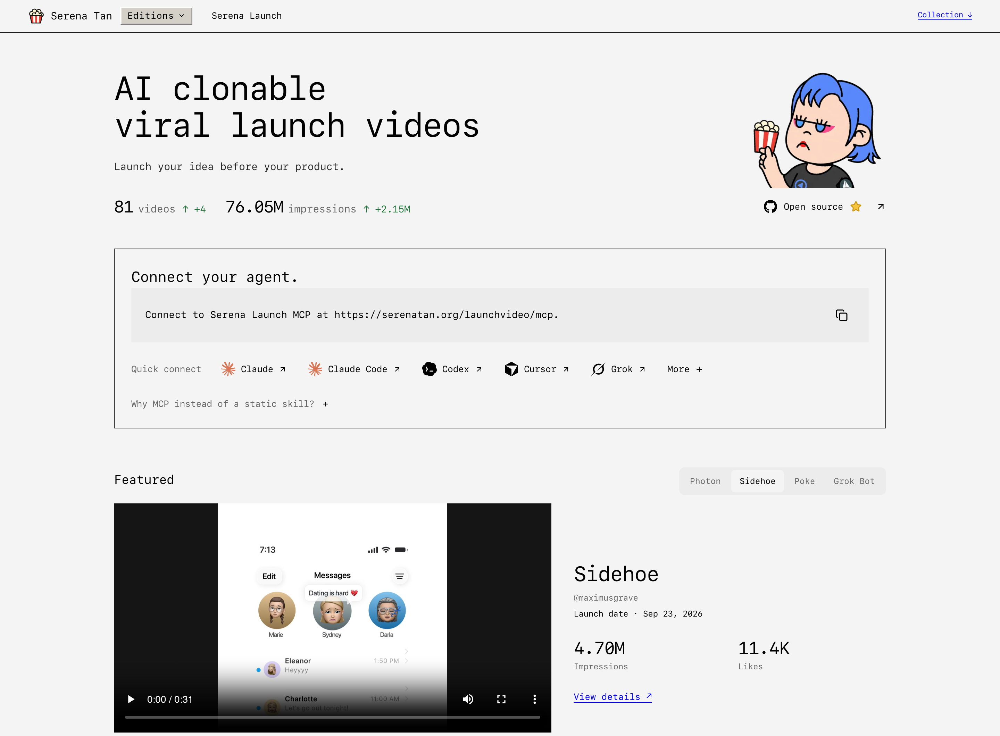

# Awesome AI Clonable Launch Videos

### ▶ [Watch the collection](https://serenatan.org/launchvideo/)



[](https://awesome.re)
[](#table-of-contents)
[](LICENSE)

> A visual collection of launch videos worth studying — with playable MP4s, performance data, and copyable prompts to clone them 1:1 for your product with AI.

For founders, designers, and builders making their next product launch. Browse a style, watch a reference, then copy the prompt and make it yours.

**Every entry includes an inline video player, the video file, a remake prompt, and credit to the original creator.** The [live site](https://serenatan.org/launchvideo/) plays videos directly in the cards; all 74 high-resolution reference files are also included in [videos/](videos/).

Inspired by the visual + copyable-prompt format of [Awesome NotebookLM Templates](https://github.com/serenakeyitan/awesome-notebookLM-prompts).

## Use with your agent

```text
set up https://serenatan.org/launchvideo/agent/SKILL.md
```

[Connect Claude, ChatGPT, Codex, Cursor, Grok & more](agent/README.md) · [Live MCP endpoint](https://serenatan.org/launchvideo/mcp) · [Plugin package](plugin/launch-archive)

The connector reads the current published library and workflow on every call. New videos and formats reach existing connections without reinstalling.

## Table of Contents

### [A. Device & UI Transformations](#device-ui-transformations)

- [Grok Bot — Online Shopping](#grok-bot-online-shopping)
- [Grok Bot — Search, Read & Monitor X](#grok-bot-search-read-monitor-x)
- [Poke — iMessage AI Assistant](#poke-imessage-ai-assistant)
- [Grok Bot — Action Button](#grok-bot-action-button)
- [Grok Bot — Vault](#grok-bot-vault)
- [Cursor — Computer Use](#cursor-computer-use)
- [Allo — Grok Bot Gets a Phone](#allo-grok-bot-gets-a-phone)
- [Notion — iPhone Duo](#notion-iphone-duo)
- [Readwise 2.0](#readwise-2-0)
- [Go-lo — Live Scores](#go-lo-live-scores)
- [Manus — Websites to Desktop Apps](#manus-websites-to-desktop-apps)
- [Ghosthand for Grok Bot — A Real iPhone](#ghosthand-grok-bot-real-iphone)
- [Grok Bot — Text Messages on Mac](#grok-bot-text-messages-on-mac)
- [Notion Calendar — Rebuilt for iOS](#notion-calendar-ios)
- [Native Cook — Mobile UI Blocks](#native-cook)
- [MCP for iPhone — Cloud Device Control](#mcp-for-iphone)
- [Pen.dev — Agentic Canvas Plugin](#pen-dev-agentic-canvas)
- [Opptics — Payments Motion Study](#opptics-payments-motion-study)

### [B. Clean UI, Data & Graphics](#clean-ui-data-graphics)

- [Grok Bot — New Shopping Experience](#grok-bot-new-shopping-experience)
- [Notion AI — Agents & More](#notion-ai-agents-more)
- [Cursor SDK — run.steer()](#cursor-sdk-run-steer)
- [Vercel — Run Your Backend](#vercel-run-your-backend)
- [BELL — Personal Assistant Stack](#bell-personal-assistant-stack)
- [Coinbase — Over / Under](#coinbase-over-under)
- [Cursor — /visualize](#cursor-visualize)
- [Coinbase — Crypto Paychecks](#coinbase-crypto-paychecks)
- [Shipper — Build Bots with AI](#shipper-build-bots-with-ai)
- [Grok Bot — Phone Calls](#grok-bot-phone-calls)
- [Notion — One Shared Brain for Every Agent](#notion-shared-brain)
- [Claude Managed Agents — Dynamic Workflows](#claude-managed-agents-dynamic-workflows)
- [Terminus Notes — Open-Source Notes](#terminus-notes)
- [Google Gemini — Motion Design Study](#google-gemini-motion-study)
- [Design-to-Code — A Skill for Every Agent](#design-to-code)
- [Commas × HighLevel — Subscription Recovery](#commas-highlevel)
- [Treg × Jev — Social API](#treg-social-api)
- [Reason — Coding Agent](#reason-coding-agent)

### [C. Pastel UI & Cursor Demos](#pastel-ui-cursor-demos)

- [Lovart — Voice Mode](#lovart-voice-mode)
- [Sidehoe](#sidehoe)
- [Krea 3](#krea-3)
- [Strawberry 1.0](#strawberry-1-0)
- [Actify AI](#actify-ai)
- [CrowdReply — Citation Outreach](#crowdreply-citation-outreach)
- [Replit AI SDR](#replit-ai-sdr)
- [Tavus PAL](#tavus-pal)
- [Oh Wait — With Context vs. Without Context](#oh-wait-context-comparison)
- [AI Workspace — Motion Design Study](#ai-workspace-motion-study)

### [D. Typography & Abstract Motion](#typography-abstract-motion)

- [AISC — Out of Stealth](#aisc-out-of-stealth)
- [TasteSkill v2](#tasteskill-v2)
- [Hermes — Profile Builder](#hermes-profile-builder)
- [Eleven Realtime](#eleven-realtime)
- [Agent Budgets — Isometric Launch Film](#agent-budgets-isometric-film)
- [Launch Video Hook — Layer Breakdown](#launch-hook-layer-breakdown)
- [Paper — Rich Text Editing](#paper-rich-text)
- [ElevenLabs — Speech Engine](#elevenlabs-speech-engine)
- [Lifted Finance — Launch Film](#lifted-finance)

### [E. Dark, Gradient & Mixed Media](#dark-gradient-mixed-media)

- [Synthesia — Syren](#synthesia-syren)
- [Vida — Desktop Agent](#vida-desktop-agent)
- [Arcads — Mark](#arcads-mark)
- [Cash App — Weekly Bitcoin Rewards](#cash-app-weekly-bitcoin-rewards)
- [Kombai 2.0](#kombai-2-0)
- [Instinct](#instinct)
- [Lightreel](#lightreel)
- [Riverside — Agentic Editor](#riverside-agentic-editor)
- [Linear — Mobile Coding Sessions](#linear-mobile-coding-sessions)
- [Readwise for OpenClaw](#readwise-for-openclaw)
- [Studiyo — Grok Bot Widget](#studiyo-grok-bot-widget)
- [Remocn v3 — Motion Components](#remocn-v3)
- [Holo — AI Marketing Motion Study](#holo-marketing-motion-study)
- [Raylight 2.0 — Editable Motion Graphics](#raylight-2)
- [Instagram Reminders — Motion Concept](#instagram-reminders-motion-concept)
- [Dnyx Studios — Imagination Upgrade](#dnyx-imagination-upgrade)
- [LandAtlas — Real Estate Workflow](#landatlas-launch)

### [F. Illustrated Mascot Stories](#illustrated-mascot-stories)

- [AffordiHome Finder — Illustrated Launch](#affordihome-finder-illustrated-launch)
- [Someone Believes in Your Idea — Landing Motion](#idea-backing-landing-motion)

---

<a id="device-ui-transformations"></a>

## A. Device & UI Transformations

Phones, floating windows, camera moves, and interfaces that change shape.

<a id="grok-bot-online-shopping"></a>

### Grok Bot — Online Shopping

https://github.com/user-attachments/assets/ce0db070-1f97-4cc7-acfe-5368dfc60a0f

**0:11 · 16:9 · 10.01M impressions · 710.7K plays**

[▶ Watch video](https://serenatan.org/launchvideo/assets/34.mp4) · [MP4 file](videos/grok-bot-online-shopping.mp4) · [Browse with stats](https://serenatan.org/launchvideo/#video-34)

A black circular mascot and one green payment-card graphic sit on a white canvas. Large captions tell one shopping feature in about eleven seconds using flat 2D shapes.

```text
clone this video 1:1 for my product
https://x.com/bot/status/2093419921007108385
```

*Source: [@bot](https://x.com/bot/status/2093419921007108385) · 2026-08-28*

<details>
<summary>Metadata & stats</summary>

| Metadata | Value |
| --- | --- |
| Posting account | @bot |
| Post date | 2026-08-28 |
| Stats snapshot (PT) | 2026-10-28 |
| Post impressions | 10,012,098 |
| Video plays | 710,732 |
| Likes | 10,120 |
| Bookmarks | 2,822 |
| Reposts | 971 |
| Replies | 703 |
| Quotes | 654 |
| Account followers | 478,073 |
| Original duration | 0:11 |
| Included file | 0:11 — full clip |
| Aspect ratio | 16:9 |
| Reference resolution | 1920 × 1080 |
| Audio track | None |

</details>

---

<a id="grok-bot-search-read-monitor-x"></a>

### Grok Bot — Search, Read & Monitor X

https://github.com/user-attachments/assets/688c0575-1c63-425e-81c2-1519321980b6

**0:12 · 16:9 · 5.92M impressions · 1.64M plays**

[▶ Watch video](https://serenatan.org/launchvideo/assets/35.mp4) · [MP4 file](videos/grok-bot-search-read-monitor-x.mp4) · [Browse with stats](https://serenatan.org/launchvideo/#video-35)

A blue question bubble opens into three tweet cards arranged as a fan. An answer bubble and an orange keyword highlight complete a compact search-and-summary story.

```text
clone this video 1:1 for my product
https://x.com/bot/status/2107949161878606089
```

*Source: [@bot](https://x.com/bot/status/2107949161878606089) · 2026-10-07*

<details>
<summary>Metadata & stats</summary>

| Metadata | Value |
| --- | --- |
| Posting account | @bot |
| Post date | 2026-10-07 |
| Stats snapshot (PT) | 2026-10-28 |
| Post impressions | 5,924,871 |
| Video plays | 1,641,145 |
| Likes | 14,953 |
| Bookmarks | 4,790 |
| Reposts | 1,234 |
| Replies | 1,865 |
| Quotes | 1,162 |
| Account followers | 478,073 |
| Original duration | 0:12 |
| Included file | 0:12 — full clip |
| Aspect ratio | 16:9 |
| Reference resolution | 1920 × 1080 |
| Audio track | Present |

</details>

---

<a id="poke-imessage-ai-assistant"></a>

### Poke — iMessage AI Assistant

https://github.com/user-attachments/assets/30c62885-c5f6-4aae-9ac9-0f953f134569

**0:43 · 4:3 · 5.04M impressions · 563.0K plays**

[▶ Watch video](https://serenatan.org/launchvideo/assets/32.mp4) · [MP4 file](videos/poke-imessage-ai-assistant.mp4) · [Browse with stats](https://serenatan.org/launchvideo/#video-32)

Pan and zoom through an iMessage inbox, chat bubbles, maps and calendar cards. Memoji, rising feature cards and a closing app-icon grid create a product story without live-action scenes.

```text
clone this video 1:1 for my product
https://x.com/interaction/status/2062575428213285352
```

*Source: [@interaction](https://x.com/interaction/status/2062575428213285352) · 2026-06-04*

<details>
<summary>Metadata & stats</summary>

| Metadata | Value |
| --- | --- |
| Posting account | @interaction |
| Post date | 2026-06-04 |
| Stats snapshot (PT) | 2026-10-28 |
| Post impressions | 5,041,332 |
| Video plays | 562,985 |
| Likes | 5,488 |
| Bookmarks | 3,077 |
| Reposts | 235 |
| Replies | 435 |
| Quotes | 442 |
| Account followers | 26,043 |
| Original duration | 0:43 |
| Included file | 0:43 — full clip |
| Aspect ratio | 4:3 |
| Reference resolution | 1440 × 1080 |
| Audio track | Present |

</details>

---

<a id="grok-bot-action-button"></a>

### Grok Bot — Action Button

https://github.com/user-attachments/assets/fe3b8890-58c6-418f-9a66-1c5bc7ca4a2e

**0:13 · 16:9 · 2.85M impressions · 904.9K plays**

[▶ Watch video](https://serenatan.org/launchvideo/assets/27.mp4) · [MP4 file](videos/grok-bot-action-button.mp4) · [Browse with stats](https://serenatan.org/launchvideo/#video-27)

A cursor selects an app icon on a stylized iPhone; the icon flies into the Action Button with a ripple. Camera pans and an expanding Dynamic Island turn device interactions into a story, followed by kinetic type and a logo reveal.

```text
clone this video 1:1 for my product
https://x.com/bot/status/2112252507762368684
```

*Source: [@bot](https://x.com/bot/status/2112252507762368684) · 2026-10-19*

<details>
<summary>Metadata & stats</summary>

| Metadata | Value |
| --- | --- |
| Posting account | @bot |
| Post date | 2026-10-19 |
| Stats snapshot (PT) | 2026-10-28 |
| Post impressions | 2,849,872 |
| Video plays | 904,920 |
| Likes | 17,483 |
| Bookmarks | 4,268 |
| Reposts | 1,111 |
| Replies | 2,347 |
| Quotes | 847 |
| Account followers | 478,073 |
| Original duration | 0:13 |
| Included file | 0:13 — full clip |
| Aspect ratio | 16:9 |
| Reference resolution | 1920 × 1080 |
| Audio track | Present |

</details>

---

<a id="grok-bot-vault"></a>

### Grok Bot — Vault

https://github.com/user-attachments/assets/12a5ee41-2262-4752-abca-d4bc264a5667

**0:19 · 16:9 · 2.14M impressions · 687.3K plays**

[▶ Watch video](https://serenatan.org/launchvideo/assets/36.mp4) · [MP4 file](videos/grok-bot-vault.mp4) · [Browse with stats](https://serenatan.org/launchvideo/#video-36)

Login forms, password fields and a vault settings screen become clean UI cards. Orange and green full-screen gradients separate the scenes and keep the hierarchy clear.

```text
clone this video 1:1 for my product
https://x.com/bot/status/2113717946019397910
```

*Source: [@bot](https://x.com/bot/status/2113717946019397910) · 2026-10-23*

<details>
<summary>Metadata & stats</summary>

| Metadata | Value |
| --- | --- |
| Posting account | @bot |
| Post date | 2026-10-23 |
| Stats snapshot (PT) | 2026-10-28 |
| Post impressions | 2,139,786 |
| Video plays | 687,296 |
| Likes | 9,172 |
| Bookmarks | 2,214 |
| Reposts | 678 |
| Replies | 1,541 |
| Quotes | 539 |
| Account followers | 478,073 |
| Original duration | 0:19 |
| Included file | 0:19 — full clip |
| Aspect ratio | 16:9 |
| Reference resolution | 1920 × 1080 |
| Audio track | None |

</details>

---

<a id="cursor-computer-use"></a>

### Cursor — Computer Use

https://github.com/user-attachments/assets/d6e2176f-c344-4b5c-a651-9c76b5363a3a

**0:21 · 16:9 · 412.2K impressions · 164.7K plays**

[▶ Watch video](https://serenatan.org/launchvideo/assets/30.mp4) · [MP4 file](videos/cursor-computer-use.mp4) · [Browse with stats](https://serenatan.org/launchvideo/#video-30)

White title frames introduce computer use, followed by an orange-gradient product scene. A Cursor window and iPhone simulator sit side by side as the cursor demonstrates the workflow, ending on the cube logo.

```text
clone this video 1:1 for my product
https://x.com/cursor_ai/status/2113661506634305834
```

*Source: [@cursor_ai](https://x.com/cursor_ai/status/2113661506634305834) · 2026-10-23*

<details>
<summary>Metadata & stats</summary>

| Metadata | Value |
| --- | --- |
| Posting account | @cursor_ai |
| Post date | 2026-10-23 |
| Stats snapshot (PT) | 2026-10-28 |
| Post impressions | 412,246 |
| Video plays | 164,700 |
| Likes | 6,420 |
| Bookmarks | 1,334 |
| Reposts | 469 |
| Replies | 532 |
| Quotes | 441 |
| Account followers | 494,611 |
| Original duration | 0:21 |
| Included file | 0:21 — full clip |
| Aspect ratio | 16:9 |
| Reference resolution | 1920 × 1080 |
| Audio track | Present |

</details>

---

<a id="allo-grok-bot-gets-a-phone"></a>

### Allo — Grok Bot Gets a Phone

https://github.com/user-attachments/assets/6e15a51f-38d6-4b3d-86d8-6291d7cbadf6

**0:20 · 16:9 · 172.4K impressions · — plays**

[▶ Watch video](https://serenatan.org/launchvideo/assets/48.mp4) · [MP4 file](videos/allo-grok-bot-gets-a-phone.mp4) · [Browse with stats](https://serenatan.org/launchvideo/#video-48)

A black circular mascot gains a green headset, then moves into an iPhone call interface on a pale background. Large captions connect answering calls, preparing callbacks and chat bubbles, before a dark green Allo logo and integration reveal.

```text
clone this video 1:1 for my product
https://x.com/allophonesystem/status/2115793573589258279
```

*Source: [@allophonesystem](https://x.com/allophonesystem/status/2115793573589258279) · 2026-10-29*

<details>
<summary>Metadata & stats</summary>

| Metadata | Value |
| --- | --- |
| Posting account | @allophonesystem |
| Post date | 2026-10-29 |
| Stats snapshot (PT) | 2026-10-29 |
| Post impressions | 172,418 |
| Video plays | — |
| Likes | 1,237 |
| Bookmarks | 764 |
| Reposts | 74 |
| Replies | 93 |
| Quotes | 29 |
| Account followers | 371 |
| Original duration | 0:20 |
| Included file | 0:20 — full clip |
| Aspect ratio | 16:9 |
| Reference resolution | 1280 × 720 |
| Audio track | Present |

</details>

---

<a id="notion-iphone-duo"></a>

### Notion — iPhone Duo

https://github.com/user-attachments/assets/d9116a27-f0de-4678-90ca-ebcd6f6c39be

**0:09 · 1.54:1 · 123.4K impressions · 48.2K plays**

[▶ Watch video](https://serenatan.org/launchvideo/assets/33.mp4) · [MP4 file](videos/notion-iphone-duo.mp4) · [Browse with stats](https://serenatan.org/launchvideo/#video-33)

A folding phone opens into a wider display while the interface rearranges to match. Keep the short film focused on one device transformation, then add scrolling and keyboard interactions.

```text
clone this video 1:1 for my product
https://x.com/NotionHQ/status/2113694972339986860
```

*Source: [@NotionHQ](https://x.com/NotionHQ/status/2113694972339986860) · 2026-10-23*

<details>
<summary>Metadata & stats</summary>

| Metadata | Value |
| --- | --- |
| Posting account | @NotionHQ |
| Post date | 2026-10-23 |
| Stats snapshot (PT) | 2026-10-28 |
| Post impressions | 123,361 |
| Video plays | 48,214 |
| Likes | 2,060 |
| Bookmarks | 180 |
| Reposts | 88 |
| Replies | 60 |
| Quotes | 28 |
| Account followers | 534,245 |
| Original duration | 0:09 |
| Included file | 0:09 — full clip |
| Aspect ratio | 1.54:1 |
| Reference resolution | 2606 × 1692 |
| Audio track | None |

</details>

---

<a id="readwise-2-0"></a>

### Readwise 2.0

https://github.com/user-attachments/assets/af1f74ec-3526-4f8d-8aa5-4f7b94423bc0

**0:35 excerpt of 1:00 · 16:9 · 70.1K impressions · 15.3K plays**

[▶ Watch video](https://serenatan.org/launchvideo/assets/28.mp4) · [MP4 file](videos/readwise-2-0.mp4) · [Browse with stats](https://serenatan.org/launchvideo/#video-28)

Floating, tilted phones on white alternate with full-screen orange gradients. Camera pans and close-ups connect reading, chat and highlighting interfaces; large captions punctuate the sequence.

```text
clone this video 1:1 for my product
https://x.com/readwise/status/2079973992077902283
```

*Source: [@readwise](https://x.com/readwise/status/2079973992077902283) · 2026-07-22*

<details>
<summary>Metadata & stats</summary>

| Metadata | Value |
| --- | --- |
| Posting account | @readwise |
| Post date | 2026-07-22 |
| Stats snapshot (PT) | 2026-10-28 |
| Post impressions | 70,081 |
| Video plays | 15,321 |
| Likes | 350 |
| Bookmarks | 121 |
| Reposts | 36 |
| Replies | 42 |
| Quotes | 26 |
| Account followers | 211,948 |
| Original duration | 1:00 |
| Included file | 0:35 — excerpt |
| Aspect ratio | 16:9 |
| Reference resolution | 3840 × 2160 |
| Audio track | Present |

</details>

---

<a id="go-lo-live-scores"></a>

### Go-lo — Live Scores

https://github.com/user-attachments/assets/d25f9e6b-9ec4-4ccb-ab51-e7d3794f2a6b

**0:10 · 1:1 · 41.3K impressions · 273 plays**

[▶ Watch video](https://serenatan.org/launchvideo/assets/29.mp4) · [MP4 file](videos/go-lo-live-scores.mp4) · [Browse with stats](https://serenatan.org/launchvideo/#video-29)

Move from an app screen to its home-screen icon, then down to a lock-screen live-score card. Device perspective and camera motion carry a single feature; the rendered phone may need more than flat UI animation to match.

```text
clone this video 1:1 for my product
https://x.com/golo_app/status/2087584902984155632
```

*Source: [@golo_app](https://x.com/golo_app/status/2087584902984155632) · 2026-08-12*

<details>
<summary>Metadata & stats</summary>

| Metadata | Value |
| --- | --- |
| Posting account | @golo_app |
| Post date | 2026-08-12 |
| Stats snapshot (PT) | 2026-10-28 |
| Post impressions | 41,268 |
| Video plays | 273 |
| Likes | 4 |
| Bookmarks | 2 |
| Reposts | 0 |
| Replies | 1 |
| Quotes | 1 |
| Account followers | 219 |
| Original duration | 0:10 |
| Included file | 0:10 — full clip |
| Aspect ratio | 1:1 |
| Reference resolution | 2160 × 2160 |
| Audio track | None |

</details>

---

<a id="manus-websites-to-desktop-apps"></a>

### Manus — Websites to Desktop Apps

https://github.com/user-attachments/assets/e59e2197-20c9-4be0-99d3-5427f3741a8e

**0:19 · 16:9 · 32.4K impressions · 11.8K plays**

[▶ Watch video](https://serenatan.org/launchvideo/assets/31.mp4) · [MP4 file](videos/manus-websites-to-desktop-apps.mp4) · [Browse with stats](https://serenatan.org/launchvideo/#video-31)

Click Install in a floating macOS window, then transform the window into a Dock icon. Spotlight, app switching and multiple windows make each click produce a visible system response.

```text
clone this video 1:1 for my product
https://x.com/ManusAI/status/2115110045977583909
```

*Source: [@ManusAI](https://x.com/ManusAI/status/2115110045977583909) · 2026-10-27*

<details>
<summary>Metadata & stats</summary>

| Metadata | Value |
| --- | --- |
| Posting account | @ManusAI |
| Post date | 2026-10-27 |
| Stats snapshot (PT) | 2026-10-28 |
| Post impressions | 32,399 |
| Video plays | 11,797 |
| Likes | 358 |
| Bookmarks | 124 |
| Reposts | 33 |
| Replies | 37 |
| Quotes | 10 |
| Account followers | 257,331 |
| Original duration | 0:19 |
| Included file | 0:19 — full clip |
| Aspect ratio | 16:9 |
| Reference resolution | 3840 × 2160 |
| Audio track | Present |

</details>

---

<a id="ghosthand-grok-bot-real-iphone"></a>

### Ghosthand for Grok Bot — A Real iPhone

https://github.com/user-attachments/assets/e179917f-89af-4519-ae1d-810cad3aa8f3

**0:43 · 16:9 · 14.1K impressions · — plays**

[▶ Watch video](https://serenatan.org/launchvideo/assets/52.mp4) · [MP4 file](videos/ghosthand-grok-bot-real-iphone.mp4) · [Browse with stats](https://serenatan.org/launchvideo/#video-52)

A floating iPhone and Grok Bot mascot introduce the product, then purple chat commands drive a real-phone TikTok publishing demo. Dark task cards expand into a grid of phone-number, app and account workflows before a gradient logo and URL end frame.

```text
clone this video 1:1 for my product
https://x.com/__morse/status/2118079056851669202
```

*Source: [@__morse](https://x.com/__morse/status/2118079056851669202) · 2026-11-04*

<details>
<summary>Metadata & stats</summary>

| Metadata | Value |
| --- | --- |
| Posting account | @__morse |
| Post date | 2026-11-04 |
| Stats snapshot (PT) | 2026-11-04 |
| Post impressions | 14,111 |
| Video plays | — |
| Likes | 178 |
| Bookmarks | 164 |
| Reposts | 9 |
| Replies | 15 |
| Quotes | 0 |
| Account followers | 7,923 |
| Original duration | 0:43 |
| Included file | 0:43 — full clip |
| Aspect ratio | 16:9 |
| Reference resolution | 1920 × 1080 |
| Audio track | Present |

</details>

---

<a id="grok-bot-text-messages-on-mac"></a>

### Grok Bot — Text Messages on Mac

https://github.com/user-attachments/assets/7bea875b-0f05-468e-83d7-8e85fe079023

**0:21 · 4:5 · 20.5K impressions · — plays**

[▶ Watch video](https://serenatan.org/launchvideo/assets/54.mp4) · [MP4 file](videos/grok-bot-text-messages-on-mac.mp4) · [Browse with stats](https://serenatan.org/launchvideo/#video-54)

Four numbered steps pair bold headings with simplified iPhone settings, a MacBook and the Grok Bot mascot on a pale background. Cursor clicks, message bubbles, dotted connectors and green confirmation checks visualize each setup step, ending on an explicit send confirmation.

```text
clone this video 1:1 for my product
https://x.com/texas_twins_dad/status/2117824974689890485
```

*Source: [@Texas_Twins_Dad](https://x.com/texas_twins_dad/status/2117824974689890485) · 2026-11-03*

<details>
<summary>Metadata & stats</summary>

| Metadata | Value |
| --- | --- |
| Posting account | @Texas_Twins_Dad |
| Post date | 2026-11-03 |
| Stats snapshot (PT) | 2026-11-04 |
| Post impressions | 20,524 |
| Video plays | — |
| Likes | 155 |
| Bookmarks | 216 |
| Reposts | 8 |
| Replies | 33 |
| Quotes | 1 |
| Account followers | 11,730 |
| Original duration | 0:21 |
| Included file | 0:21 — full clip |
| Aspect ratio | 4:5 |
| Reference resolution | 1080 × 1350 |
| Audio track | Present |

</details>

---

<a id="notion-calendar-ios"></a>

### Notion Calendar — Rebuilt for iOS

https://github.com/user-attachments/assets/357f2a1d-3d53-4442-b9b6-38c8cef14ff3

**0:15 · 16:9 · 123.9K impressions · — plays**

[▶ Watch video](https://serenatan.org/launchvideo/assets/55.mp4) · [MP4 file](videos/notion-calendar-ios.mp4) · [Browse with stats](https://serenatan.org/launchvideo/#video-55)

A close-up iPhone dock opens into pastel calendar blocks, with bold feature captions on an off-white background. Calendar details and event edits lead to a family of phone, tablet and desktop mockups, then return to the app icon.

```text
clone this video 1:1 for my product
https://x.com/NotionHQ/status/2118407963723567512
```

*Source: [@NotionHQ](https://x.com/NotionHQ/status/2118407963723567512) · 2026-11-05*

<details>
<summary>Metadata & stats</summary>

| Metadata | Value |
| --- | --- |
| Posting account | @NotionHQ |
| Post date | 2026-11-05 |
| Stats snapshot (PT) | 2026-11-06 |
| Post impressions | 123,872 |
| Video plays | — |
| Likes | 891 |
| Bookmarks | 217 |
| Reposts | 60 |
| Replies | 49 |
| Quotes | 21 |
| Account followers | 536,325 |
| Original duration | 0:15 |
| Included file | 0:15 — full clip |
| Aspect ratio | 16:9 |
| Reference resolution | 1920 × 1080 |
| Audio track | Present |

</details>

---

<a id="native-cook"></a>

### Native Cook — Mobile UI Blocks

https://github.com/user-attachments/assets/1c443874-7dfe-4807-9e69-720b37042fec

**0:53 · 16:9 · 24.9K impressions · — plays**

[▶ Watch video](https://serenatan.org/launchvideo/assets/59.mp4) · [MP4 file](videos/native-cook.mp4) · [Browse with stats](https://serenatan.org/launchvideo/#video-59)

On a dark canvas, large white type introduces a library of mobile UI blocks before colorful phone mockups show animated screens. The demo moves from a block preview to copying a Swift prompt, running code and viewing the result in an iOS simulator, with yellow text highlights and short caption pills.

```text
clone this video 1:1 for my product
https://x.com/ngocdevv/status/2117645490057892004
```

*Source: [@ngocdevv](https://x.com/ngocdevv/status/2117645490057892004) · 2026-11-03*

<details>
<summary>Metadata & stats</summary>

| Metadata | Value |
| --- | --- |
| Posting account | @ngocdevv |
| Post date | 2026-11-03 |
| Stats snapshot (PT) | 2026-11-06 |
| Post impressions | 24,898 |
| Video plays | — |
| Likes | 574 |
| Bookmarks | 743 |
| Reposts | 54 |
| Replies | 22 |
| Quotes | 6 |
| Account followers | 299 |
| Original duration | 0:53 |
| Included file | 0:53 — full clip |
| Aspect ratio | 16:9 |
| Reference resolution | 1920 × 1080 |
| Audio track | Present |

</details>

---

<a id="mcp-for-iphone"></a>

### MCP for iPhone — Cloud Device Control

https://github.com/user-attachments/assets/8bbf9f95-922e-464a-bf58-1a911f9ace5c

**0:59 · 16:9 · 95.7K impressions · — plays**

[▶ Watch video](https://serenatan.org/launchvideo/assets/61.mp4) · [MP4 file](videos/mcp-for-iphone.mp4) · [Browse with stats](https://serenatan.org/launchvideo/#video-61)

A black device-service mark on a pale canvas leads into connecting an MCP endpoint, sending a chat prompt and operating a real iPhone interface. Phone screens, social-post panels, a weekly planner and a grid of devices demonstrate the workflow with short explanatory headlines.

```text
clone this video 1:1 for my product
https://x.com/HamonPaulm/status/2118309946190172318
```

*Source: [@HamonPaulm](https://x.com/HamonPaulm/status/2118309946190172318) · 2026-11-05*

<details>
<summary>Metadata & stats</summary>

| Metadata | Value |
| --- | --- |
| Posting account | @HamonPaulm |
| Post date | 2026-11-05 |
| Stats snapshot (PT) | 2026-11-06 |
| Post impressions | 95,730 |
| Video plays | — |
| Likes | 808 |
| Bookmarks | 1,175 |
| Reposts | 69 |
| Replies | 65 |
| Quotes | 15 |
| Account followers | 807 |
| Original duration | 0:59 |
| Included file | 0:59 — full clip |
| Aspect ratio | 16:9 |
| Reference resolution | 1920 × 1080 |
| Audio track | Present |

</details>

---

<a id="pen-dev-agentic-canvas"></a>

### Pen.dev — Agentic Canvas Plugin

https://github.com/user-attachments/assets/b2cf2d6c-fc43-4cd9-b98c-e9b2acea36f5

**0:18 · 16:9 · 149.5K impressions · — plays**

[▶ Watch video](https://serenatan.org/launchvideo/assets/66.mp4) · [MP4 file](videos/pen-dev-agentic-canvas.mp4) · [Browse with stats](https://serenatan.org/launchvideo/#video-66)

Large metallic pen-nib and ChatGPT-style marks move across a pale background before the canvas interface appears. A typed import prompt brings a dashboard onto the canvas; bright metric cards, pixel-like numerals and cursor movements lead to the pen.dev closing mark.

```text
clone this video 1:1 for my product
https://x.com/tomkrcha/status/2117336830559617513
```

*Source: [@tomkrcha](https://x.com/tomkrcha/status/2117336830559617513) · 2026-11-02*

<details>
<summary>Metadata & stats</summary>

| Metadata | Value |
| --- | --- |
| Posting account | @tomkrcha |
| Post date | 2026-11-02 |
| Stats snapshot (PT) | 2026-11-06 |
| Post impressions | 149,546 |
| Video plays | — |
| Likes | 902 |
| Bookmarks | 831 |
| Reposts | 42 |
| Replies | 40 |
| Quotes | 11 |
| Account followers | 26,097 |
| Original duration | 0:18 |
| Included file | 0:18 — full clip |
| Aspect ratio | 16:9 |
| Reference resolution | 1920 × 1080 |
| Audio track | Present |

</details>

---

<a id="opptics-payments-motion-study"></a>

### Opptics — Payments Motion Study

https://github.com/user-attachments/assets/75e4fdc6-ddf2-4140-b83d-8da1705b9c84

**0:21 · 16:9 · 16.1K impressions · — plays**

[▶ Watch video](https://serenatan.org/launchvideo/assets/78.mp4) · [MP4 file](videos/opptics-payments-motion-study.mp4) · [Browse with stats](https://serenatan.org/launchvideo/#video-78)

Bright perspective cards combine payment notices, a piggy bank, gears, stars and colorful radial ribbons. Large typography about payout timing, fees and approvals alternates with stylized payment UI before the Opptics end card.

```text
clone this video 1:1 for my product
https://x.com/Nexoxh/status/2116053584223547792
```

*Source: [@Nexoxh](https://x.com/Nexoxh/status/2116053584223547792) · 2026-10-29*

<details>
<summary>Metadata & stats</summary>

| Metadata | Value |
| --- | --- |
| Posting account | @Nexoxh |
| Post date | 2026-10-29 |
| Stats snapshot (PT) | 2026-11-06 |
| Post impressions | 16,089 |
| Video plays | — |
| Likes | 566 |
| Bookmarks | 273 |
| Reposts | 25 |
| Replies | 29 |
| Quotes | 1 |
| Account followers | 5,702 |
| Original duration | 0:21 |
| Included file | 0:21 — full clip |
| Aspect ratio | 16:9 |
| Reference resolution | 1024 × 576 |
| Audio track | Present |

</details>

---

<a id="clean-ui-data-graphics"></a>

## B. Clean UI, Data & Graphics

One focal point per scene: charts, code cards, simple geometry, and useful product actions.

<a id="grok-bot-new-shopping-experience"></a>

### Grok Bot — New Shopping Experience

https://github.com/user-attachments/assets/c9aba1cb-2a58-43d4-a50a-fc9d9d0da781

**0:17 · 16:9 · 212.5K impressions · — plays**

[▶ Watch video](https://serenatan.org/launchvideo/assets/50.mp4) · [MP4 file](videos/grok-bot-new-shopping-experience.mp4) · [Browse with stats](https://serenatan.org/launchvideo/#video-50)

A minimal chat request expands into a carousel of product cards, followed by a detailed shopping view on white. An oversized cursor selects a shoe size and clicks Buy now, then a receipt message resolves into the Grok Bot logo.

```text
clone this video 1:1 for my product
https://x.com/bot/status/2117736249444507834
```

*Source: [@bot](https://x.com/bot/status/2117736249444507834) · 2026-11-03*

<details>
<summary>Metadata & stats</summary>

| Metadata | Value |
| --- | --- |
| Posting account | @bot |
| Post date | 2026-11-03 |
| Stats snapshot (PT) | 2026-11-03 |
| Post impressions | 212,498 |
| Video plays | — |
| Likes | 2,540 |
| Bookmarks | 613 |
| Reposts | 194 |
| Replies | 424 |
| Quotes | 107 |
| Account followers | 501,290 |
| Original duration | 0:17 |
| Included file | 0:17 — full clip |
| Aspect ratio | 16:9 |
| Reference resolution | 1920 × 1080 |
| Audio track | Present |

</details>

---

<a id="notion-ai-agents-more"></a>

### Notion AI — Agents & More

https://github.com/user-attachments/assets/aebd26f9-1b86-45f5-97df-a0b83820d18b

**0:35 excerpt of 0:51 · 16:9 · 181.0K impressions · 61.6K plays**

[▶ Watch video](https://serenatan.org/launchvideo/assets/41.mp4) · [MP4 file](videos/notion-ai-agents-more.mp4) · [Browse with stats](https://serenatan.org/launchvideo/#video-41)

Muted peach and cream scenes give each feature its own full-screen color. Large titles, scrolling model names and cursor clicks create a compact sequence of AI updates.

```text
clone this video 1:1 for my product
https://x.com/NotionHQ/status/2112269722075242887
```

*Source: [@NotionHQ](https://x.com/NotionHQ/status/2112269722075242887) · 2026-10-19*

<details>
<summary>Metadata & stats</summary>

| Metadata | Value |
| --- | --- |
| Posting account | @NotionHQ |
| Post date | 2026-10-19 |
| Stats snapshot (PT) | 2026-10-28 |
| Post impressions | 181,002 |
| Video plays | 61,581 |
| Likes | 904 |
| Bookmarks | 408 |
| Reposts | 84 |
| Replies | 150 |
| Quotes | 87 |
| Account followers | 534,245 |
| Original duration | 0:51 |
| Included file | 0:35 — excerpt |
| Aspect ratio | 16:9 |
| Reference resolution | 1920 × 1080 |
| Audio track | Present |

</details>

---

<a id="cursor-sdk-run-steer"></a>

### Cursor SDK — run.steer()

https://github.com/user-attachments/assets/72edc146-63f8-4239-80eb-c2491f6b927b

**0:20 · 16:9 · 141.6K impressions · 54.1K plays**

[▶ Watch video](https://serenatan.org/launchvideo/assets/44.mp4) · [MP4 file](videos/cursor-sdk-run-steer.mp4) · [Browse with stats](https://serenatan.org/launchvideo/#video-44)

Type code into a white snippet card and highlight individual lines. A short, restrained sequence uses typography and code motion to explain the SDK method.

```text
clone this video 1:1 for my product
https://x.com/cursor_ai/status/2107141004482793827
```

*Source: [@cursor_ai](https://x.com/cursor_ai/status/2107141004482793827) · 2026-10-05*

<details>
<summary>Metadata & stats</summary>

| Metadata | Value |
| --- | --- |
| Posting account | @cursor_ai |
| Post date | 2026-10-05 |
| Stats snapshot (PT) | 2026-10-28 |
| Post impressions | 141,560 |
| Video plays | 54,078 |
| Likes | 1,339 |
| Bookmarks | 220 |
| Reposts | 84 |
| Replies | 146 |
| Quotes | 66 |
| Account followers | 494,611 |
| Original duration | 0:20 |
| Included file | 0:20 — full clip |
| Aspect ratio | 16:9 |
| Reference resolution | 1920 × 1080 |
| Audio track | None |

</details>

---

<a id="vercel-run-your-backend"></a>

### Vercel — Run Your Backend

https://github.com/user-attachments/assets/a069a1c4-91e1-4691-9185-3934a3b31c77

**0:12 · 16:9 · 136.9K impressions · 49.1K plays**

[▶ Watch video](https://serenatan.org/launchvideo/assets/40.mp4) · [MP4 file](videos/vercel-run-your-backend.mp4) · [Browse with stats](https://serenatan.org/launchvideo/#video-40)

White wireframe triangles and cubes animate on a black canvas. Small frontend/backend labels keep the twelve-second geometric story precise and restrained.

```text
clone this video 1:1 for my product
https://x.com/vercel/status/2110786348131258456
```

*Source: [@vercel](https://x.com/vercel/status/2110786348131258456) · 2026-10-15*

<details>
<summary>Metadata & stats</summary>

| Metadata | Value |
| --- | --- |
| Posting account | @vercel |
| Post date | 2026-10-15 |
| Stats snapshot (PT) | 2026-10-28 |
| Post impressions | 136,877 |
| Video plays | 49,074 |
| Likes | 1,001 |
| Bookmarks | 273 |
| Reposts | 67 |
| Replies | 62 |
| Quotes | 43 |
| Account followers | 467,982 |
| Original duration | 0:12 |
| Included file | 0:12 — full clip |
| Aspect ratio | 16:9 |
| Reference resolution | 1920 × 1080 |
| Audio track | None |

</details>

---

<a id="bell-personal-assistant-stack"></a>

### BELL — Personal Assistant Stack

https://github.com/user-attachments/assets/a42fafb1-0880-4e9f-9038-b97b6ecba7cd

**0:24 · 16:9 · 101.7K impressions · 31.5K plays**

[▶ Watch video](https://serenatan.org/launchvideo/assets/42.mp4) · [MP4 file](videos/bell-personal-assistant-stack.mp4) · [Browse with stats](https://serenatan.org/launchvideo/#video-42)

A white canvas and orange accents connect search, phone UI, two-dot eyes and a thinking state. Logo blocks spring into a stack, making the personal-assistant toolkit visible as a simple metaphor.

```text
clone this video 1:1 for my product
https://x.com/browserbase/status/2114777924335554605
```

*Source: [@browserbase](https://x.com/browserbase/status/2114777924335554605) · 2026-10-26*

<details>
<summary>Metadata & stats</summary>

| Metadata | Value |
| --- | --- |
| Posting account | @browserbase |
| Post date | 2026-10-26 |
| Stats snapshot (PT) | 2026-10-28 |
| Post impressions | 101,668 |
| Video plays | 31,498 |
| Likes | 553 |
| Bookmarks | 650 |
| Reposts | 36 |
| Replies | 40 |
| Quotes | 35 |
| Account followers | 22,145 |
| Original duration | 0:24 |
| Included file | 0:24 — full clip |
| Aspect ratio | 16:9 |
| Reference resolution | 1920 × 1080 |
| Audio track | Present |

</details>

---

<a id="coinbase-over-under"></a>

### Coinbase — Over / Under

https://github.com/user-attachments/assets/ced7aef3-9bac-4929-9cf0-93cdd6975a25

**0:30 · 16:9 · 96.7K impressions · 12.6K plays**

[▶ Watch video](https://serenatan.org/launchvideo/assets/37.mp4) · [MP4 file](videos/coinbase-over-under.mp4) · [Browse with stats](https://serenatan.org/launchvideo/#video-37)

A blue logo frame gives way to green/red probability pills, a moving point on a chart and a countdown. Limit each scene to one focal element, then reveal a phone chart and return to the blue logo frame.

```text
clone this video 1:1 for my product
https://x.com/coinbase/status/2114148184285143349
```

*Source: [@coinbase](https://x.com/coinbase/status/2114148184285143349) · 2026-10-24*

<details>
<summary>Metadata & stats</summary>

| Metadata | Value |
| --- | --- |
| Posting account | @coinbase |
| Post date | 2026-10-24 |
| Stats snapshot (PT) | 2026-10-28 |
| Post impressions | 96,697 |
| Video plays | 12,557 |
| Likes | 263 |
| Bookmarks | 13 |
| Reposts | 29 |
| Replies | 85 |
| Quotes | 9 |
| Account followers | 7,192,388 |
| Original duration | 0:30 |
| Included file | 0:30 — full clip |
| Aspect ratio | 16:9 |
| Reference resolution | 1920 × 1080 |
| Audio track | Present |

</details>

---

<a id="cursor-visualize"></a>

### Cursor — /visualize

https://github.com/user-attachments/assets/3c9db2e9-af82-4198-adf3-6efe141a0230

**0:27 · 16:9 · 83.3K impressions · 28.9K plays**

[▶ Watch video](https://serenatan.org/launchvideo/assets/43.mp4) · [MP4 file](videos/cursor-visualize.mp4) · [Browse with stats](https://serenatan.org/launchvideo/#video-43)

Type /visualize into a minimal off-white chat interface. Draw a line chart, show hover/filter interactions, then turn a follow-up question into a growing bar chart.

```text
clone this video 1:1 for my product
https://x.com/cursor_ai/status/2108289748628566496
```

*Source: [@cursor_ai](https://x.com/cursor_ai/status/2108289748628566496) · 2026-10-08*

<details>
<summary>Metadata & stats</summary>

| Metadata | Value |
| --- | --- |
| Posting account | @cursor_ai |
| Post date | 2026-10-08 |
| Stats snapshot (PT) | 2026-10-28 |
| Post impressions | 83,261 |
| Video plays | 28,864 |
| Likes | 1,288 |
| Bookmarks | 207 |
| Reposts | 78 |
| Replies | 121 |
| Quotes | 19 |
| Account followers | 494,611 |
| Original duration | 0:27 |
| Included file | 0:27 — full clip |
| Aspect ratio | 16:9 |
| Reference resolution | 1920 × 1080 |
| Audio track | None |

</details>

---

<a id="coinbase-crypto-paychecks"></a>

### Coinbase — Crypto Paychecks

https://github.com/user-attachments/assets/ad8c8b75-de9a-48d3-824f-99b0ba33b9be

**0:26 · 16:9 · 82.3K impressions · 7.8K plays**

[▶ Watch video](https://serenatan.org/launchvideo/assets/38.mp4) · [MP4 file](videos/coinbase-crypto-paychecks.mp4) · [Browse with stats](https://serenatan.org/launchvideo/#video-38)

Blue concentric circles become a row of colored dots, then a ring and an asset-allocation pie chart. Simple geometric morphs connect the story before the chart resolves inside a phone interface.

```text
clone this video 1:1 for my product
https://x.com/coinbase/status/2114718467610022208
```

*Source: [@coinbase](https://x.com/coinbase/status/2114718467610022208) · 2026-10-26*

<details>
<summary>Metadata & stats</summary>

| Metadata | Value |
| --- | --- |
| Posting account | @coinbase |
| Post date | 2026-10-26 |
| Stats snapshot (PT) | 2026-10-28 |
| Post impressions | 82,330 |
| Video plays | 7,786 |
| Likes | 325 |
| Bookmarks | 18 |
| Reposts | 36 |
| Replies | 60 |
| Quotes | 6 |
| Account followers | 7,192,388 |
| Original duration | 0:26 |
| Included file | 0:26 — full clip |
| Aspect ratio | 16:9 |
| Reference resolution | 1920 × 1080 |
| Audio track | Present |

</details>

---

<a id="shipper-build-bots-with-ai"></a>

### Shipper — Build Bots with AI

https://github.com/user-attachments/assets/7459dba7-a19b-42aa-bd34-5c6183bcdf6a

**0:23 · 16:9 · 56.1K impressions · 14.7K plays**

[▶ Watch video](https://serenatan.org/launchvideo/assets/39.mp4) · [MP4 file](videos/shipper-build-bots-with-ai.mp4) · [Browse with stats](https://serenatan.org/launchvideo/#video-39)

Brand icons float above white UI cards with soft shadows. Large title frames and straightforward 2D transitions introduce bot-building across messaging platforms.

```text
clone this video 1:1 for my product
https://x.com/chddaniel/status/2048402359110557714
```

*Source: [@chddaniel](https://x.com/chddaniel/status/2048402359110557714) · 2026-04-26*

<details>
<summary>Metadata & stats</summary>

| Metadata | Value |
| --- | --- |
| Posting account | @chddaniel |
| Post date | 2026-04-26 |
| Stats snapshot (PT) | 2026-10-28 |
| Post impressions | 56,144 |
| Video plays | 14,744 |
| Likes | 422 |
| Bookmarks | 533 |
| Reposts | 13 |
| Replies | 56 |
| Quotes | 3 |
| Account followers | 28,520 |
| Original duration | 0:23 |
| Included file | 0:23 — full clip |
| Aspect ratio | 16:9 |
| Reference resolution | 1280 × 720 |
| Audio track | Present |

</details>

---

<a id="grok-bot-phone-calls"></a>

### Grok Bot — Phone Calls

https://github.com/user-attachments/assets/d1cee917-3816-416c-970f-363a41987474

**0:42 · 16:9 · 1.41M impressions · — plays**

[▶ Watch video](https://serenatan.org/launchvideo/assets/53.mp4) · [MP4 file](videos/grok-bot-phone-calls.mp4) · [Browse with stats](https://serenatan.org/launchvideo/#video-53)

A minimal white chat shows an expiring internet contract, then turns a phone-call button into an animated call timer and live transcript. Orange reply bubbles, sparse intertitles and a compact call panel lead to a cancellation confirmation and a simple Grok Bot logo close.

```text
clone this video 1:1 for my product
https://x.com/bot/status/2118043939592942052
```

*Source: [@bot](https://x.com/bot/status/2118043939592942052) · 2026-11-04*

<details>
<summary>Metadata & stats</summary>

| Metadata | Value |
| --- | --- |
| Posting account | @bot |
| Post date | 2026-11-04 |
| Stats snapshot (PT) | 2026-11-04 |
| Post impressions | 1,409,107 |
| Video plays | — |
| Likes | 10,077 |
| Bookmarks | 2,268 |
| Reposts | 551 |
| Replies | 2,392 |
| Quotes | 475 |
| Account followers | 507,165 |
| Original duration | 0:42 |
| Included file | 0:42 — full clip |
| Aspect ratio | 16:9 |
| Reference resolution | 1920 × 1080 |
| Audio track | Present |

</details>

---

<a id="notion-shared-brain"></a>

### Notion — One Shared Brain for Every Agent

https://github.com/user-attachments/assets/9fa5ec1c-2d09-4802-8a2e-cc60a318c006

**0:36 · 16:9 · 1.44M impressions · — plays**

[▶ Watch video](https://serenatan.org/launchvideo/assets/56.mp4) · [MP4 file](videos/notion-shared-brain.mp4) · [Browse with stats](https://serenatan.org/launchvideo/#video-56)

Large black headlines introduce shared memory, followed by floating terminal windows and a Notion memories database. A phone conversation and the database appear side by side, connected by a hand-drawn arrow before a simple Notion logo close.

```text
clone this video 1:1 for my product
https://x.com/NotionHQ/status/2118059335930744999
```

*Source: [@NotionHQ](https://x.com/NotionHQ/status/2118059335930744999) · 2026-11-04*

<details>
<summary>Metadata & stats</summary>

| Metadata | Value |
| --- | --- |
| Posting account | @NotionHQ |
| Post date | 2026-11-04 |
| Stats snapshot (PT) | 2026-11-06 |
| Post impressions | 1,437,538 |
| Video plays | — |
| Likes | 6,006 |
| Bookmarks | 8,290 |
| Reposts | 553 |
| Replies | 464 |
| Quotes | 528 |
| Account followers | 536,325 |
| Original duration | 0:36 |
| Included file | 0:36 — full clip |
| Aspect ratio | 16:9 |
| Reference resolution | 1920 × 1080 |
| Audio track | Present |

</details>

---

<a id="claude-managed-agents-dynamic-workflows"></a>

### Claude Managed Agents — Dynamic Workflows

https://github.com/user-attachments/assets/aec5765d-3501-4817-8829-67d42c0d4fd9

**0:58 · 16:9 · 1.04M impressions · — plays**

[▶ Watch video](https://serenatan.org/launchvideo/assets/58.mp4) · [MP4 file](videos/claude-managed-agents-dynamic-workflows.mp4) · [Browse with stats](https://serenatan.org/launchvideo/#video-58)

An orange agent dot, document stacks and thin black diagrams explain how a large task splits into parallel phases and recombines. Workflow rows turn into branching lines, a result counter, a phase timeline and a budget bar on a warm off-white canvas, ending on the Claude mark.

```text
clone this video 1:1 for my product
https://x.com/ClaudeDevs/status/2108591328732856655
```

*Source: [@ClaudeDevs](https://x.com/ClaudeDevs/status/2108591328732856655) · 2026-10-09*

<details>
<summary>Metadata & stats</summary>

| Metadata | Value |
| --- | --- |
| Posting account | @ClaudeDevs |
| Post date | 2026-10-09 |
| Stats snapshot (PT) | 2026-11-06 |
| Post impressions | 1,043,404 |
| Video plays | — |
| Likes | 12,542 |
| Bookmarks | 8,450 |
| Reposts | 728 |
| Replies | 429 |
| Quotes | 286 |
| Account followers | 800,149 |
| Original duration | 0:58 |
| Included file | 0:58 — full clip |
| Aspect ratio | 16:9 |
| Reference resolution | 1920 × 1080 |
| Audio track | None |

</details>

---

<a id="terminus-notes"></a>

### Terminus Notes — Open-Source Notes

https://github.com/user-attachments/assets/8fb93e0f-22c0-4e85-bc8d-33533a8e4e1e

**0:45 · 16:9 · 827.9K impressions · — plays**

[▶ Watch video](https://serenatan.org/launchvideo/assets/60.mp4) · [MP4 file](videos/terminus-notes.mp4) · [Browse with stats](https://serenatan.org/launchvideo/#video-60)

An off-white opening combines serif type, broken Notion-style letter blocks and a blue horse icon before moving into a clean notes workspace. A launch checklist and Paris travel page demonstrate editing, an AI chat panel and an embedded map with changing styles, ending with free and open-source messaging and the Terminus Notes title.

```text
clone this video 1:1 for my product
https://x.com/WinstonGu_/status/2117336804705927410
```

*Source: [@WinstonGu_](https://x.com/WinstonGu_/status/2117336804705927410) · 2026-11-02*

<details>
<summary>Metadata & stats</summary>

| Metadata | Value |
| --- | --- |
| Posting account | @WinstonGu_ |
| Post date | 2026-11-02 |
| Stats snapshot (PT) | 2026-11-06 |
| Post impressions | 827,870 |
| Video plays | — |
| Likes | 5,311 |
| Bookmarks | 5,990 |
| Reposts | 342 |
| Replies | 275 |
| Quotes | 129 |
| Account followers | 1,512 |
| Original duration | 0:45 |
| Included file | 0:45 — full clip |
| Aspect ratio | 16:9 |
| Reference resolution | 1920 × 1080 |
| Audio track | Present |

</details>

---

<a id="google-gemini-motion-study"></a>

### Google Gemini — Motion Design Study

https://github.com/user-attachments/assets/8343e405-b9f4-4f0b-bf9e-4771d2a1abe0

**0:18 · 16:9 · 8.7K impressions · — plays**

[▶ Watch video](https://serenatan.org/launchvideo/assets/65.mp4) · [MP4 file](videos/google-gemini-motion-study.mp4) · [Browse with stats](https://serenatan.org/launchvideo/#video-65)

The Google mark connects to document, map, mail and video-call icons through thin branching lines. Blue text selections, a glowing prompt box, the Gemini mark and simplified document-sharing UI tell the story on a white canvas.

```text
clone this video 1:1 for my product
https://x.com/Nexoxh/status/2118411690970599718
```

*Source: [@Nexoxh](https://x.com/Nexoxh/status/2118411690970599718) · 2026-11-05*

<details>
<summary>Metadata & stats</summary>

| Metadata | Value |
| --- | --- |
| Posting account | @Nexoxh |
| Post date | 2026-11-05 |
| Stats snapshot (PT) | 2026-11-06 |
| Post impressions | 8,660 |
| Video plays | — |
| Likes | 250 |
| Bookmarks | 148 |
| Reposts | 12 |
| Replies | 26 |
| Quotes | 2 |
| Account followers | 5,702 |
| Original duration | 0:18 |
| Included file | 0:18 — full clip |
| Aspect ratio | 16:9 |
| Reference resolution | 1024 × 576 |
| Audio track | Present |

</details>

---

<a id="design-to-code"></a>

### Design-to-Code — A Skill for Every Agent

https://github.com/user-attachments/assets/aa40f6f4-597f-4363-b8d1-35fb56c4ca23

**0:35 · 16:9 · 31.0K impressions · — plays**

[▶ Watch video](https://serenatan.org/launchvideo/assets/70.mp4) · [MP4 file](videos/design-to-code.mp4) · [Browse with stats](https://serenatan.org/launchvideo/#video-70)

A faint grid, light-blue text selections and pixel-block transitions introduce turning design references into code. Website comparisons, a terminal checklist and a chain from the agent to the design-to-code skill lead to the install-command end card.

```text
clone this video 1:1 for my product
https://x.com/athrix_codes/status/2117596718019789205
```

*Source: [@athrix_codes](https://x.com/athrix_codes/status/2117596718019789205) · 2026-11-03*

<details>
<summary>Metadata & stats</summary>

| Metadata | Value |
| --- | --- |
| Posting account | @athrix_codes |
| Post date | 2026-11-03 |
| Stats snapshot (PT) | 2026-11-06 |
| Post impressions | 31,032 |
| Video plays | — |
| Likes | 569 |
| Bookmarks | 716 |
| Reposts | 45 |
| Replies | 64 |
| Quotes | 8 |
| Account followers | 4,075 |
| Original duration | 0:35 |
| Included file | 0:35 — full clip |
| Aspect ratio | 16:9 |
| Reference resolution | 1920 × 1080 |
| Audio track | Present |

</details>

---

<a id="commas-highlevel"></a>

### Commas × HighLevel — Subscription Recovery

https://github.com/user-attachments/assets/932d6d86-7140-4de9-a23b-d23f0cdf8285

**0:51 · 16:9 · 3.6K impressions · — plays**

[▶ Watch video](https://serenatan.org/launchvideo/assets/72.mp4) · [MP4 file](videos/commas-highlevel.mp4) · [Browse with stats](https://serenatan.org/launchvideo/#video-72)

Blue glass-like buttons, a pointer and a payment panel introduce a billing workflow on a white background. Failed-subscription copy gives way to recovery messaging, a revenue line chart and the Commas × HighLevel closing card.

```text
clone this video 1:1 for my product
https://x.com/abdullah4204k/status/2118417123731186095
```

*Source: [@abdullah4204k](https://x.com/abdullah4204k/status/2118417123731186095) · 2026-11-05*

<details>
<summary>Metadata & stats</summary>

| Metadata | Value |
| --- | --- |
| Posting account | @abdullah4204k |
| Post date | 2026-11-05 |
| Stats snapshot (PT) | 2026-11-06 |
| Post impressions | 3,610 |
| Video plays | — |
| Likes | 135 |
| Bookmarks | 108 |
| Reposts | 3 |
| Replies | 5 |
| Quotes | 1 |
| Account followers | 3,932 |
| Original duration | 0:51 |
| Included file | 0:51 — full clip |
| Aspect ratio | 16:9 |
| Reference resolution | 1920 × 1080 |
| Audio track | Present |

</details>

---

<a id="treg-social-api"></a>

### Treg × Jev — Social API

https://github.com/user-attachments/assets/a7866910-d6ee-496d-a1c8-269fa8e4d750

**0:54 · 16:9 · 130.8K impressions · — plays**

[▶ Watch video](https://serenatan.org/launchvideo/assets/75.mp4) · [MP4 file](videos/treg-social-api.mp4) · [Browse with stats](https://serenatan.org/launchvideo/#video-75)

A central terminal prompt is surrounded by social-platform icons, then moves through a decoded video, mention boards and creator data. Headphones imagery, relationship diagrams, audience bars and dashboard cards lead to the Jev and Treg end card.

```text
clone this video 1:1 for my product
https://x.com/treg_ai/status/2118660249150427243
```

*Source: [@treg_ai](https://x.com/treg_ai/status/2118660249150427243) · 2026-11-06*

<details>
<summary>Metadata & stats</summary>

| Metadata | Value |
| --- | --- |
| Posting account | @treg_ai |
| Post date | 2026-11-06 |
| Stats snapshot (PT) | 2026-11-06 |
| Post impressions | 130,795 |
| Video plays | — |
| Likes | 1,326 |
| Bookmarks | 1,944 |
| Reposts | 79 |
| Replies | 107 |
| Quotes | 75 |
| Account followers | 8,760 |
| Original duration | 0:54 |
| Included file | 0:54 — full clip |
| Aspect ratio | 16:9 |
| Reference resolution | 1920 × 1080 |
| Audio track | Present |

</details>

---

<a id="reason-coding-agent"></a>

### Reason — Coding Agent

https://github.com/user-attachments/assets/34a114e9-fb84-44de-ae04-97f5b3c41ef9

**0:29 · 16:9 · 25.5K impressions · — plays**

[▶ Watch video](https://serenatan.org/launchvideo/assets/79.mp4) · [MP4 file](videos/reason-coding-agent.mp4) · [Browse with stats](https://serenatan.org/launchvideo/#video-79)

Usage bars and a short out-of-usage headline introduce Reason on a warm off-white canvas. Side-by-side coding interfaces and benchmark-style bars compare the advertised workflow before a free-trial closing card; the claims are presented as source-video content.

```text
clone this video 1:1 for my product
https://x.com/reasonmachines/status/2117986868004573695
```

*Source: [@reasonmachines](https://x.com/reasonmachines/status/2117986868004573695) · 2026-11-04*

<details>
<summary>Metadata & stats</summary>

| Metadata | Value |
| --- | --- |
| Posting account | @reasonmachines |
| Post date | 2026-11-04 |
| Stats snapshot (PT) | 2026-11-06 |
| Post impressions | 25,480 |
| Video plays | — |
| Likes | 335 |
| Bookmarks | 209 |
| Reposts | 14 |
| Replies | 42 |
| Quotes | 2 |
| Account followers | 13,939 |
| Original duration | 0:29 |
| Included file | 0:29 — full clip |
| Aspect ratio | 16:9 |
| Reference resolution | 1920 × 1080 |
| Audio track | Present |

</details>

---

<a id="pastel-ui-cursor-demos"></a>

## C. Pastel UI & Cursor Demos

Product stories driven by clear interfaces, oversized cursors, and quick visual payoffs.

<a id="lovart-voice-mode"></a>

### Lovart — Voice Mode

https://github.com/user-attachments/assets/54b478bc-597d-43d5-9db8-3a42a203426c

**0:45 · 16:9 · 5.15M impressions · 2.18M plays**

[▶ Watch video](https://serenatan.org/launchvideo/assets/02.mp4) · [MP4 file](videos/lovart-voice-mode.mp4) · [Browse with stats](https://serenatan.org/launchvideo/#video-2)

Alternate black and white title frames with a clean voice-input interface. AI-generated image collages expand into a visual demonstration of voice edits.

```text
clone this video 1:1 for my product
https://x.com/lovart_ai/status/2033904987277774951
```

*Source: [@lovart_ai](https://x.com/lovart_ai/status/2033904987277774951) · 2026-03-17*

<details>
<summary>Metadata & stats</summary>

| Metadata | Value |
| --- | --- |
| Posting account | @lovart_ai |
| Post date | 2026-03-17 |
| Stats snapshot (PT) | 2026-10-27 |
| Post impressions | 5,150,093 |
| Video plays | 2,181,155 |
| Likes | 545 |
| Bookmarks | 163 |
| Reposts | 42 |
| Replies | 33 |
| Quotes | 7 |
| Account followers | 32,504 |
| Original duration | 0:45 |
| Included file | 0:45 — full clip |
| Aspect ratio | 16:9 |
| Reference resolution | 2880 × 1600 |
| Audio track | Present |

</details>

---

<a id="sidehoe"></a>

### Sidehoe

https://github.com/user-attachments/assets/bfa4ba44-9d9a-4d0b-81e2-c4df05da9446

**0:31 · 1:1 · 4.70M impressions · 766.9K plays**

[▶ Watch video](https://serenatan.org/launchvideo/assets/03.mp4) · [MP4 file](videos/sidehoe.mp4) · [Browse with stats](https://serenatan.org/launchvideo/#video-3)

Pink-purple gradients frame iMessage inboxes, chat bubbles, Memoji and floating app icons. An oversized cursor introduces a new feature every three to four seconds.

```text
clone this video 1:1 for my product
https://x.com/maximusgrave/status/2102800008982777902
```

*Source: [@maximusgrave](https://x.com/maximusgrave/status/2102800008982777902) · 2026-09-23*

<details>
<summary>Metadata & stats</summary>

| Metadata | Value |
| --- | --- |
| Posting account | @maximusgrave |
| Post date | 2026-09-23 |
| Stats snapshot (PT) | 2026-10-28 |
| Post impressions | 4,696,408 |
| Video plays | 766,906 |
| Likes | 11,440 |
| Bookmarks | 6,252 |
| Reposts | 446 |
| Replies | 684 |
| Quotes | 823 |
| Account followers | 2,788 |
| Original duration | 0:31 |
| Included file | 0:31 — full clip |
| Aspect ratio | 1:1 |
| Reference resolution | 2000 × 2000 |
| Audio track | Present |

</details>

---

<a id="krea-3"></a>

### Krea 3

https://github.com/user-attachments/assets/5b3f4a89-cf72-4684-8fbd-a42eb1e55279

**0:35 · 16:9 · 1.33M impressions · 103.5K plays**

[▶ Watch video](https://serenatan.org/launchvideo/assets/09.mp4) · [MP4 file](videos/krea-3.mp4) · [Browse with stats](https://serenatan.org/launchvideo/#video-9)

White and pale-gray scenes, a giant blue cursor and floating image cards. Pair “4x faster” charts and an Arena ranking with a precise-editing demonstration.

```text
clone this video 1:1 for my product
https://x.com/krea_ai/status/2112567020353102324
```

*Source: [@krea_ai](https://x.com/krea_ai/status/2112567020353102324) · 2026-10-20*

<details>
<summary>Metadata & stats</summary>

| Metadata | Value |
| --- | --- |
| Posting account | @krea_ai |
| Post date | 2026-10-20 |
| Stats snapshot (PT) | 2026-10-27 |
| Post impressions | 1,331,959 |
| Video plays | 103,493 |
| Likes | 1,631 |
| Bookmarks | 1,180 |
| Reposts | 192 |
| Replies | 122 |
| Quotes | 165 |
| Account followers | 122,869 |
| Original duration | 0:35 |
| Included file | 0:35 — full clip |
| Aspect ratio | 16:9 |
| Reference resolution | 1920 × 1080 |
| Audio track | Present |

</details>

---

<a id="strawberry-1-0"></a>

### Strawberry 1.0

https://github.com/user-attachments/assets/9265c072-cbcf-4bde-867b-d3b1d679ae91

**0:35 excerpt of 1:30 · 16:9 · 1.22M impressions · 172.3K plays**

[▶ Watch video](https://serenatan.org/launchvideo/assets/11.mp4) · [MP4 file](videos/strawberry-1-0.mp4) · [Browse with stats](https://serenatan.org/launchvideo/#video-11)

Cartoon characters and large kinetic titles lead into LinkedIn, calendar and meeting UI. Frequent zooms and quick scene changes create a dense product-story rhythm; the included file is a 35-second excerpt.

```text
clone this video 1:1 for my product
https://x.com/charles_maddock/status/2114659351470247986
```

*Source: [@charles_maddock](https://x.com/charles_maddock/status/2114659351470247986) · 2026-10-26*

<details>
<summary>Metadata & stats</summary>

| Metadata | Value |
| --- | --- |
| Posting account | @charles_maddock |
| Post date | 2026-10-26 |
| Stats snapshot (PT) | 2026-10-28 |
| Post impressions | 1,218,068 |
| Video plays | 172,278 |
| Likes | 4,366 |
| Bookmarks | 4,624 |
| Reposts | 280 |
| Replies | 333 |
| Quotes | 221 |
| Account followers | 9,928 |
| Original duration | 1:30 |
| Included file | 0:35 — excerpt |
| Aspect ratio | 16:9 |
| Reference resolution | 1920 × 1080 |
| Audio track | Present |

</details>

---

<a id="actify-ai"></a>

### Actify AI

https://github.com/user-attachments/assets/9b68d56f-5ceb-4979-844f-0ea31161aa62

**0:38 · 16:9 · 377.5K impressions · 1.2K plays**

[▶ Watch video](https://serenatan.org/launchvideo/assets/19.mp4) · [MP4 file](videos/actify-ai.mp4) · [Browse with stats](https://serenatan.org/launchvideo/#video-19)

Pale gray and purple full-screen frames introduce the job-search problem. Small type and an input UI carry a restrained demo, ending on the Actify logo.

```text
clone this video 1:1 for my product
https://x.com/ActifyAI/status/2080331695560274183
```

*Source: [@ActifyAI](https://x.com/ActifyAI/status/2080331695560274183) · 2026-07-23*

<details>
<summary>Metadata & stats</summary>

| Metadata | Value |
| --- | --- |
| Posting account | @ActifyAI |
| Post date | 2026-07-23 |
| Stats snapshot (PT) | 2026-10-27 |
| Post impressions | 377,523 |
| Video plays | 1,158 |
| Likes | 63 |
| Bookmarks | 10 |
| Reposts | 4 |
| Replies | 31 |
| Quotes | 2 |
| Account followers | 113 |
| Original duration | 0:38 |
| Included file | 0:38 — full clip |
| Aspect ratio | 16:9 |
| Reference resolution | 2560 × 1440 |
| Audio track | Present |

</details>

---

<a id="crowdreply-citation-outreach"></a>

### CrowdReply — Citation Outreach

https://github.com/user-attachments/assets/ee4cf7a6-d741-4fc2-8562-48c70245bd57

**0:58 · 16:9 · 361.1K impressions · 68.6K plays**

[▶ Watch video](https://serenatan.org/launchvideo/assets/20.mp4) · [MP4 file](videos/crowdreply-citation-outreach.mp4) · [Browse with stats](https://serenatan.org/launchvideo/#video-20)

White UI with app icons, an “Opportunity Missed!” alert, tables and an oversized cursor. Conversational title frames lead into a workflow diagram and a soft-gradient close.

```text
clone this video 1:1 for my product
https://x.com/CrowdReply_io/status/2105312058451570973
```

*Source: [@CrowdReply_io](https://x.com/CrowdReply_io/status/2105312058451570973) · 2026-09-30*

<details>
<summary>Metadata & stats</summary>

| Metadata | Value |
| --- | --- |
| Posting account | @CrowdReply_io |
| Post date | 2026-09-30 |
| Stats snapshot (PT) | 2026-10-27 |
| Post impressions | 361,082 |
| Video plays | 68,580 |
| Likes | 699 |
| Bookmarks | 1,296 |
| Reposts | 41 |
| Replies | 60 |
| Quotes | 52 |
| Account followers | 17,039 |
| Original duration | 0:58 |
| Included file | 0:58 — full clip |
| Aspect ratio | 16:9 |
| Reference resolution | 1920 × 1080 |
| Audio track | Present |

</details>

---

<a id="replit-ai-sdr"></a>

### Replit AI SDR

https://github.com/user-attachments/assets/1b912b46-54f0-430b-9235-e7cf33d1adf0

**0:33 · 16:9 · 279.2K impressions · 61.7K plays**

[▶ Watch video](https://serenatan.org/launchvideo/assets/21.mp4) · [MP4 file](videos/replit-ai-sdr.mp4) · [Browse with stats](https://serenatan.org/launchvideo/#video-21)

Cream canvas and big red type introduce “Your next 100 customers are waiting.” Strike through manual, tedious and expensive; reveal tables and counters, then a logo close.

```text
clone this video 1:1 for my product
https://x.com/samuel_spitz/status/2041198900791714278
```

*Source: [@samuel_spitz](https://x.com/samuel_spitz/status/2041198900791714278) · 2026-04-06*

<details>
<summary>Metadata & stats</summary>

| Metadata | Value |
| --- | --- |
| Posting account | @samuel_spitz |
| Post date | 2026-04-06 |
| Stats snapshot (PT) | 2026-10-27 |
| Post impressions | 279,168 |
| Video plays | 61,696 |
| Likes | 770 |
| Bookmarks | 1,193 |
| Reposts | 26 |
| Replies | 48 |
| Quotes | 16 |
| Account followers | 34,278 |
| Original duration | 0:33 |
| Included file | 0:33 — full clip |
| Aspect ratio | 16:9 |
| Reference resolution | 1928 × 1080 |
| Audio track | Present |

</details>

---

<a id="tavus-pal"></a>

### Tavus PAL

https://github.com/user-attachments/assets/b8d44ce6-96ec-4156-8aa7-f0ac878099d6

**0:45 excerpt of 1:05 · 16:9 · 164.6K impressions · 27.6K plays**

[▶ Watch video](https://serenatan.org/launchvideo/assets/26.mp4) · [MP4 file](videos/tavus-pal.mp4) · [Browse with stats](https://serenatan.org/launchvideo/#video-26)

Cream and pink-orange gradients with slow-moving titles, calendar UI and meeting windows. Expanding rings link “Google Meet” to “Your PAL,” ending on Tavus branding.

```text
clone this video 1:1 for my product
https://x.com/tavus/status/2074894605125026072
```

*Source: [@tavus](https://x.com/tavus/status/2074894605125026072) · 2026-07-08*

<details>
<summary>Metadata & stats</summary>

| Metadata | Value |
| --- | --- |
| Posting account | @tavus |
| Post date | 2026-07-08 |
| Stats snapshot (PT) | 2026-10-27 |
| Post impressions | 164,598 |
| Video plays | 27,624 |
| Likes | 328 |
| Bookmarks | 237 |
| Reposts | 70 |
| Replies | 28 |
| Quotes | 12 |
| Account followers | 43,533 |
| Original duration | 1:05 |
| Included file | 0:45 — excerpt |
| Aspect ratio | 16:9 |
| Reference resolution | 1280 × 720 |
| Audio track | Present |

</details>

---

<a id="oh-wait-context-comparison"></a>

### Oh Wait — With Context vs. Without Context

https://github.com/user-attachments/assets/4c9d62a2-a17e-449a-98bd-23069fea34f7

**0:30 · 4:3 · 18.8K impressions · — plays**

[▶ Watch video](https://serenatan.org/launchvideo/assets/57.mp4) · [MP4 file](videos/oh-wait-context-comparison.mp4) · [Browse with stats](https://serenatan.org/launchvideo/#video-57)

Two iPhone mockups compare a pink checklist interface with an editorial fashion and packing experience throughout the clip. Rapid screen changes combine cut-out product and fashion photography, serif headlines, checklist rows and bottom navigation.

```text
clone this video 1:1 for my product
https://x.com/jaimintf/status/2118396459150344437
```

*Source: [@jaimintf](https://x.com/jaimintf/status/2118396459150344437) · 2026-11-05*

<details>
<summary>Metadata & stats</summary>

| Metadata | Value |
| --- | --- |
| Posting account | @jaimintf |
| Post date | 2026-11-05 |
| Stats snapshot (PT) | 2026-11-06 |
| Post impressions | 18,847 |
| Video plays | — |
| Likes | 314 |
| Bookmarks | 428 |
| Reposts | 8 |
| Replies | 12 |
| Quotes | 4 |
| Account followers | 6,094 |
| Original duration | 0:30 |
| Included file | 0:30 — full clip |
| Aspect ratio | 4:3 |
| Reference resolution | 2880 × 2160 |
| Audio track | None |

</details>

---

<a id="ai-workspace-motion-study"></a>

### AI Workspace — Motion Design Study

https://github.com/user-attachments/assets/a2d37684-8609-4d0c-87b7-d29b969226b7

**0:30 · 16:9 · 27.0K impressions · — plays**

[▶ Watch video](https://serenatan.org/launchvideo/assets/64.mp4) · [MP4 file](videos/ai-workspace-motion-study.mp4) · [Browse with stats](https://serenatan.org/launchvideo/#video-64)

Thermal-colored imagery and soft gradients introduce an AI workspace, followed by oversized lettering against a sky of clouds. A prompt field, image-generation progress steps and fashion-photo collages use floating panels and changing scale on a light canvas.

```text
clone this video 1:1 for my product
https://x.com/rajzmotion/status/2117525794637697456
```

*Source: [@rajzmotion](https://x.com/rajzmotion/status/2117525794637697456) · 2026-11-02*

<details>
<summary>Metadata & stats</summary>

| Metadata | Value |
| --- | --- |
| Posting account | @rajzmotion |
| Post date | 2026-11-02 |
| Stats snapshot (PT) | 2026-11-06 |
| Post impressions | 27,038 |
| Video plays | — |
| Likes | 726 |
| Bookmarks | 622 |
| Reposts | 22 |
| Replies | 32 |
| Quotes | 0 |
| Account followers | 1,510 |
| Original duration | 0:30 |
| Included file | 0:30 — full clip |
| Aspect ratio | 16:9 |
| Reference resolution | 1920 × 1080 |
| Audio track | Present |

</details>

---

<a id="typography-abstract-motion"></a>

## D. Typography & Abstract Motion

Kinetic type, counters, glowing outlines, rings, and waveform-led product stories.

<a id="aisc-out-of-stealth"></a>

### AISC — Out of Stealth

https://github.com/user-attachments/assets/ba4ac478-1c84-48c9-8acc-6b2e084f34c8

**0:33 · 16:9 · 1.07M impressions · 42.5K plays**

[▶ Watch video](https://serenatan.org/launchvideo/assets/12.mp4) · [MP4 file](videos/aisc-out-of-stealth.mp4) · [Browse with stats](https://serenatan.org/launchvideo/#video-12)

Cream and dark frames alternate around a “Stop burning your budget” hook. Counters, social-post UI, comment bubbles and an icon grid build toward the logo.

```text
clone this video 1:1 for my product
https://x.com/aiscwork/status/2090862009008984574
```

*Source: [@aiscwork](https://x.com/aiscwork/status/2090862009008984574) · 2026-08-21*

<details>
<summary>Metadata & stats</summary>

| Metadata | Value |
| --- | --- |
| Posting account | @aiscwork |
| Post date | 2026-08-21 |
| Stats snapshot (PT) | 2026-10-27 |
| Post impressions | 1,066,893 |
| Video plays | 42,493 |
| Likes | 428 |
| Bookmarks | 218 |
| Reposts | 103 |
| Replies | 61 |
| Quotes | 16 |
| Account followers | 15,281 |
| Original duration | 0:33 |
| Included file | 0:33 — full clip |
| Aspect ratio | 16:9 |
| Reference resolution | 1920 × 1080 |
| Audio track | Present |

</details>

---

<a id="tasteskill-v2"></a>

### TasteSkill v2

https://github.com/user-attachments/assets/0453c796-297e-480a-b39d-565846afc871

**0:50 excerpt of 1:04 · 16:9 · 571.8K impressions · 163.4K plays**

[▶ Watch video](https://serenatan.org/launchvideo/assets/14.mp4) · [MP4 file](videos/tasteskill-v2.mp4) · [Browse with stats](https://serenatan.org/launchvideo/#video-14)

Minimal white frames with “Give your agent taste” and editorial image accents. Typography drives the story, closing on a black installation-command frame.

```text
clone this video 1:1 for my product
https://x.com/LexnLin/status/2110122106537050584
```

*Source: [@LexnLin](https://x.com/LexnLin/status/2110122106537050584) · 2026-10-13*

<details>
<summary>Metadata & stats</summary>

| Metadata | Value |
| --- | --- |
| Posting account | @LexnLin |
| Post date | 2026-10-13 |
| Stats snapshot (PT) | 2026-10-27 |
| Post impressions | 571,812 |
| Video plays | 163,398 |
| Likes | 4,709 |
| Bookmarks | 8,868 |
| Reposts | 235 |
| Replies | 103 |
| Quotes | 51 |
| Account followers | 32,498 |
| Original duration | 1:04 |
| Included file | 0:50 — excerpt |
| Aspect ratio | 16:9 |
| Reference resolution | 1920 × 1080 |
| Audio track | Present |

</details>

---

<a id="hermes-profile-builder"></a>

### Hermes — Profile Builder

https://github.com/user-attachments/assets/06d390e1-39b6-49ed-931c-43de48cb24f4

**0:47 · 1:1 · 546.6K impressions · 75.8K plays**

[▶ Watch video](https://serenatan.org/launchvideo/assets/15.mp4) · [MP4 file](videos/hermes-profile-builder.mp4) · [Browse with stats](https://serenatan.org/launchvideo/#video-15)

Black canvas with rough, glowing outlines and hand-drawn-looking cards. Identity → model provider → skills → MCPs → review, in a square composition.

```text
clone this video 1:1 for my product
https://x.com/NousResearch/status/2064760263224504719
```

*Source: [@NousResearch](https://x.com/NousResearch/status/2064760263224504719) · 2026-06-10*

<details>
<summary>Metadata & stats</summary>

| Metadata | Value |
| --- | --- |
| Posting account | @NousResearch |
| Post date | 2026-06-10 |
| Stats snapshot (PT) | 2026-10-27 |
| Post impressions | 546,620 |
| Video plays | 75,795 |
| Likes | 2,971 |
| Bookmarks | 1,396 |
| Reposts | 216 |
| Replies | 165 |
| Quotes | 68 |
| Account followers | 290,528 |
| Original duration | 0:47 |
| Included file | 0:47 — full clip |
| Aspect ratio | 1:1 |
| Reference resolution | 2160 × 2160 |
| Audio track | Present |

</details>

---

<a id="eleven-realtime"></a>

### Eleven Realtime

https://github.com/user-attachments/assets/2fef8eb6-2738-4a1e-bdbb-aaad64f08eeb

**0:45 excerpt of 1:11 · 16:9 · 223.1K impressions · 74.4K plays**

[▶ Watch video](https://serenatan.org/launchvideo/assets/23.mp4) · [MP4 file](videos/eleven-realtime.mp4) · [Browse with stats](https://serenatan.org/launchvideo/#video-23)

Minimal black, white and gray; spheres, rings, waveforms and dialogue captions. Abstract motion and model-tier labels carry a voice-product story.

```text
clone this video 1:1 for my product
https://x.com/ElevenLabs/status/2112550782063247521
```

*Source: [@ElevenLabs](https://x.com/ElevenLabs/status/2112550782063247521) · 2026-10-20*

<details>
<summary>Metadata & stats</summary>

| Metadata | Value |
| --- | --- |
| Posting account | @ElevenLabs |
| Post date | 2026-10-20 |
| Stats snapshot (PT) | 2026-10-27 |
| Post impressions | 223,094 |
| Video plays | 74,421 |
| Likes | 2,509 |
| Bookmarks | 1,208 |
| Reposts | 190 |
| Replies | 137 |
| Quotes | 105 |
| Account followers | 208,922 |
| Original duration | 1:11 |
| Included file | 0:45 — excerpt |
| Aspect ratio | 16:9 |
| Reference resolution | 1920 × 1080 |
| Audio track | Present |

</details>

---

<a id="agent-budgets-isometric-film"></a>

### Agent Budgets — Isometric Launch Film

https://github.com/user-attachments/assets/c2d2719e-aaae-4e86-b9b0-3fd73adf3f19

**1:08 · 16:9 · 8.7K impressions · — plays**

[▶ Watch video](https://serenatan.org/launchvideo/assets/68.mp4) · [MP4 file](videos/agent-budgets-isometric-film.mp4) · [Browse with stats](https://serenatan.org/launchvideo/#video-68)

Neon green panels, black grid lines and large white type frame an isometric story about teams and budgets. Colored cubes, numerical limits, expanding geometry and graph-like paths alternate between flat compositions and perspective views.

```text
clone this video 1:1 for my product
https://x.com/MarkKnd/status/2118682213139001373
```

*Source: [@MarkKnd](https://x.com/MarkKnd/status/2118682213139001373) · 2026-11-06*

<details>
<summary>Metadata & stats</summary>

| Metadata | Value |
| --- | --- |
| Posting account | @MarkKnd |
| Post date | 2026-11-06 |
| Stats snapshot (PT) | 2026-11-06 |
| Post impressions | 8,708 |
| Video plays | — |
| Likes | 327 |
| Bookmarks | 240 |
| Reposts | 10 |
| Replies | 16 |
| Quotes | 1 |
| Account followers | 40,660 |
| Original duration | 1:08 |
| Included file | 1:08 — full clip |
| Aspect ratio | 16:9 |
| Reference resolution | 1920 × 1080 |
| Audio track | Present |

</details>

---

<a id="launch-hook-layer-breakdown"></a>

### Launch Video Hook — Layer Breakdown

https://github.com/user-attachments/assets/39994253-a288-414a-b72b-d8a9de208592

**0:14 · 16:9 · 3.4K impressions · — plays**

[▶ Watch video](https://serenatan.org/launchvideo/assets/69.mp4) · [MP4 file](videos/launch-hook-layer-breakdown.mp4) · [Browse with stats](https://serenatan.org/launchvideo/#video-69)

A production breakdown exposes selection boxes, motion paths, handles and overlapping layers behind an app-launch hook. Vintage cutout images, serif lettering, pixel-style pointers and colored feature requests animate on a pale yellow canvas.

```text
clone this video 1:1 for my product
https://x.com/Jerrythe2d/status/2118730912901042221
```

*Source: [@Jerrythe2d](https://x.com/Jerrythe2d/status/2118730912901042221) · 2026-11-06*

<details>
<summary>Metadata & stats</summary>

| Metadata | Value |
| --- | --- |
| Posting account | @Jerrythe2d |
| Post date | 2026-11-06 |
| Stats snapshot (PT) | 2026-11-06 |
| Post impressions | 3,413 |
| Video plays | — |
| Likes | 241 |
| Bookmarks | 137 |
| Reposts | 3 |
| Replies | 9 |
| Quotes | 0 |
| Account followers | 6,369 |
| Original duration | 0:14 |
| Included file | 0:14 — full clip |
| Aspect ratio | 16:9 |
| Reference resolution | 2880 × 1620 |
| Audio track | Present |

</details>

---

<a id="paper-rich-text"></a>

### Paper — Rich Text Editing

https://github.com/user-attachments/assets/c9121b6d-b09d-477c-a892-c239e8c44750

**0:45 · 1:1 · 38.2K impressions · — plays**

[▶ Watch video](https://serenatan.org/launchvideo/assets/73.mp4) · [MP4 file](videos/paper-rich-text.mp4) · [Browse with stats](https://serenatan.org/launchvideo/#video-73)

Collaborative cursors and live selections turn a short line of text into a sequence of changing letterforms and contrasting type treatments. The square clip shifts between light and dark canvases, letter grids and oversized editorial layouts before the Paper mark.

```text
clone this video 1:1 for my product
https://x.com/stephenhaney/status/2117333603608932710
```

*Source: [@stephenhaney](https://x.com/stephenhaney/status/2117333603608932710) · 2026-11-02*

<details>
<summary>Metadata & stats</summary>

| Metadata | Value |
| --- | --- |
| Posting account | @stephenhaney |
| Post date | 2026-11-02 |
| Stats snapshot (PT) | 2026-11-06 |
| Post impressions | 38,183 |
| Video plays | — |
| Likes | 661 |
| Bookmarks | 171 |
| Reposts | 28 |
| Replies | 52 |
| Quotes | 10 |
| Account followers | 21,434 |
| Original duration | 0:45 |
| Included file | 0:45 — full clip |
| Aspect ratio | 1:1 |
| Reference resolution | 1080 × 1080 |
| Audio track | Present |

</details>

---

<a id="elevenlabs-speech-engine"></a>

### ElevenLabs — Speech Engine

https://github.com/user-attachments/assets/33e6f7da-09d4-4c1d-be3b-571071d0e34a

**0:54 · 16:9 · 18.68M impressions · — plays**

[▶ Watch video](https://serenatan.org/launchvideo/assets/74.mp4) · [MP4 file](videos/elevenlabs-speech-engine.mp4) · [Browse with stats](https://serenatan.org/launchvideo/#video-74)

A softly lit metallic sphere moves between dark and light compositions alongside chat bubbles and minimal captions. Integration blocks, multilingual speech examples and turn-taking labels explain the voice-agent workflow before the ElevenLabs closing mark.

```text
clone this video 1:1 for my product
https://x.com/ElevenLabsDevs/status/2057919237566407063
```

*Source: [@ElevenLabsDevs](https://x.com/ElevenLabsDevs/status/2057919237566407063) · 2026-05-22*

<details>
<summary>Metadata & stats</summary>

| Metadata | Value |
| --- | --- |
| Posting account | @ElevenLabsDevs |
| Post date | 2026-05-22 |
| Stats snapshot (PT) | 2026-11-06 |
| Post impressions | 18,678,618 |
| Video plays | — |
| Likes | 3,522 |
| Bookmarks | 2,281 |
| Reposts | 426 |
| Replies | 245 |
| Quotes | 27 |
| Account followers | 23,830 |
| Original duration | 0:54 |
| Included file | 0:54 — full clip |
| Aspect ratio | 16:9 |
| Reference resolution | 1280 × 720 |
| Audio track | Present |

</details>

---

<a id="lifted-finance"></a>

### Lifted Finance — Launch Film

https://github.com/user-attachments/assets/baaee9a0-ba32-4317-adff-edeb5e316b50

**0:34 · 16:9 · 2.7K impressions · — plays**

[▶ Watch video](https://serenatan.org/launchvideo/assets/81.mp4) · [MP4 file](videos/lifted-finance.mp4) · [Browse with stats](https://serenatan.org/launchvideo/#video-81)

Minimal white typography introduces a yield question on a black canvas, with thin chart lines and outlined financial symbols. Animated spread curves and a leverage gauge illustrate the product before a compact Lifted Finance logo end card.

```text
clone this video 1:1 for my product
https://x.com/BuffetDesigns/status/2117225648595022031
```

*Source: [@BuffetDesigns](https://x.com/BuffetDesigns/status/2117225648595022031) · 2026-11-02*

<details>
<summary>Metadata & stats</summary>

| Metadata | Value |
| --- | --- |
| Posting account | @BuffetDesigns |
| Post date | 2026-11-02 |
| Stats snapshot (PT) | 2026-11-06 |
| Post impressions | 2,704 |
| Video plays | — |
| Likes | 66 |
| Bookmarks | 39 |
| Reposts | 10 |
| Replies | 8 |
| Quotes | 1 |
| Account followers | 6,317 |
| Original duration | 0:34 |
| Included file | 0:34 — full clip |
| Aspect ratio | 16:9 |
| Reference resolution | 1920 × 1080 |
| Audio track | Present |

</details>

---

<a id="dark-gradient-mixed-media"></a>

## E. Dark, Gradient & Mixed Media

Dark interfaces, floating devices, image collage, and product demos mixed with people or generated footage.

<a id="synthesia-syren"></a>

### Synthesia — Syren

https://github.com/user-attachments/assets/870e16d9-c055-45c7-af1f-f6f9e6d9da55

**1:01 · 16:9 · 1.49M impressions · 46.4K plays**

[▶ Watch video](https://serenatan.org/launchvideo/assets/07.mp4) · [MP4 file](videos/synthesia-syren.mp4) · [Browse with stats](https://serenatan.org/launchvideo/#video-7)

The video is presented as an AI-generated Syren demo. Kinetic typography and brand cards mix with an AI presenter and a logo reveal.

```text
clone this video 1:1 for my product
https://x.com/vriparbelli/status/2107850981614489957
```

*Source: [@vriparbelli](https://x.com/vriparbelli/status/2107850981614489957) · 2026-10-07*

<details>
<summary>Metadata & stats</summary>

| Metadata | Value |
| --- | --- |
| Posting account | @vriparbelli |
| Post date | 2026-10-07 |
| Stats snapshot (PT) | 2026-10-27 |
| Post impressions | 1,489,041 |
| Video plays | 46,430 |
| Likes | 342 |
| Bookmarks | 385 |
| Reposts | 65 |
| Replies | 64 |
| Quotes | 107 |
| Account followers | 7,161 |
| Original duration | 1:01 |
| Included file | 1:01 — full clip |
| Aspect ratio | 16:9 |
| Reference resolution | 1920 × 1080 |
| Audio track | Present |

</details>

---

<a id="vida-desktop-agent"></a>

### Vida — Desktop Agent

https://github.com/user-attachments/assets/66360a9c-5968-4e3d-8ced-2d4bfe43e5b2

**1:02 · 16:9 · 1.29M impressions · 22.8K plays**

[▶ Watch video](https://serenatan.org/launchvideo/assets/10.mp4) · [MP4 file](videos/vida-desktop-agent.mp4) · [Browse with stats](https://serenatan.org/launchvideo/#video-10)

A short laptop shot introduces desktop windows, floating prompts and a large number counter. Caption-led storytelling moves from screen chaos to an agent doing useful work.

```text
clone this video 1:1 for my product
https://x.com/vida_agent/status/2069718855551955194
```

*Source: [@vida_agent](https://x.com/vida_agent/status/2069718855551955194) · 2026-06-24*

<details>
<summary>Metadata & stats</summary>

| Metadata | Value |
| --- | --- |
| Posting account | @vida_agent |
| Post date | 2026-06-24 |
| Stats snapshot (PT) | 2026-10-27 |
| Post impressions | 1,290,840 |
| Video plays | 22,779 |
| Likes | 865 |
| Bookmarks | 818 |
| Reposts | 117 |
| Replies | 128 |
| Quotes | 198 |
| Account followers | 714 |
| Original duration | 1:02 |
| Included file | 1:02 — full clip |
| Aspect ratio | 16:9 |
| Reference resolution | 1920 × 1080 |
| Audio track | Present |

</details>

---

<a id="arcads-mark"></a>

### Arcads — Mark

https://github.com/user-attachments/assets/29365212-0950-4805-aaf6-c9c113b60018

**0:50 excerpt of 1:08 · 16:9 · 653.2K impressions · 78.6K plays**

[▶ Watch video](https://serenatan.org/launchvideo/assets/13.mp4) · [MP4 file](videos/arcads-mark.mp4) · [Browse with stats](https://serenatan.org/launchvideo/#video-13)

Dark, glowing interface cards: competitor scraping, suggestions and a mascot. Large cursor clicks and ad thumbnails combine a product reveal with a funding announcement.

```text
clone this video 1:1 for my product
https://x.com/arcads_ai/status/2084611105528115415
```

*Source: [@arcads_ai](https://x.com/arcads_ai/status/2084611105528115415) · 2026-08-04*

<details>
<summary>Metadata & stats</summary>

| Metadata | Value |
| --- | --- |
| Posting account | @arcads_ai |
| Post date | 2026-08-04 |
| Stats snapshot (PT) | 2026-10-27 |
| Post impressions | 653,216 |
| Video plays | 78,595 |
| Likes | 1,224 |
| Bookmarks | 1,762 |
| Reposts | 60 |
| Replies | 207 |
| Quotes | 96 |
| Account followers | 12,388 |
| Original duration | 1:08 |
| Included file | 0:50 — excerpt |
| Aspect ratio | 16:9 |
| Reference resolution | 1920 × 1080 |
| Audio track | Present |

</details>

---

<a id="cash-app-weekly-bitcoin-rewards"></a>

### Cash App — Weekly Bitcoin Rewards

https://github.com/user-attachments/assets/b3c3d59c-4de9-476e-bd63-7e77c999b5e5

**0:17 · 1:1 · 506.0K impressions · 87.5K plays**

[▶ Watch video](https://serenatan.org/launchvideo/assets/45.mp4) · [MP4 file](videos/cash-app-weekly-bitcoin-rewards.mp4) · [Browse with stats](https://serenatan.org/launchvideo/#video-45)

A floating phone switches between an app launch screen, a toggle, a lock-screen notification and a reward result. A fluid multicolor gradient supplies atmosphere; much of the phone content resembles actual app footage.

```text
clone this video 1:1 for my product
https://x.com/CashApp/status/2103207687127466307
```

*Source: [@CashApp](https://x.com/CashApp/status/2103207687127466307) · 2026-09-24*

<details>
<summary>Metadata & stats</summary>

| Metadata | Value |
| --- | --- |
| Posting account | @CashApp |
| Post date | 2026-09-24 |
| Stats snapshot (PT) | 2026-10-28 |
| Post impressions | 505,968 |
| Video plays | 87,478 |
| Likes | 736 |
| Bookmarks | 172 |
| Reposts | 94 |
| Replies | 127 |
| Quotes | 28 |
| Account followers | 2,002,490 |
| Original duration | 0:17 |
| Included file | 0:17 — full clip |
| Aspect ratio | 1:1 |
| Reference resolution | 2160 × 2160 |
| Audio track | None |

</details>

---

<a id="kombai-2-0"></a>

### Kombai 2.0

https://github.com/user-attachments/assets/608cc9ed-1994-413e-973c-cbe157d049e3

**0:45 excerpt of 1:25 · 16:9 · 443.2K impressions · 51.1K plays**

[▶ Watch video](https://serenatan.org/launchvideo/assets/16.mp4) · [MP4 file](videos/kombai-2-0.mp4) · [Browse with stats](https://serenatan.org/launchvideo/#video-16)

A founder introduction gives way to web-design windows, terminal scenes and a bold “DOMINATE” frame. Finish with a green gradient and the AI design engineer proposition.

```text
clone this video 1:1 for my product
https://x.com/Dipanjan_Dey/status/2061825199247614316
```

*Source: [@Dipanjan_Dey](https://x.com/Dipanjan_Dey/status/2061825199247614316) · 2026-06-02*

<details>
<summary>Metadata & stats</summary>

| Metadata | Value |
| --- | --- |
| Posting account | @Dipanjan_Dey |
| Post date | 2026-06-02 |
| Stats snapshot (PT) | 2026-10-27 |
| Post impressions | 443,209 |
| Video plays | 51,109 |
| Likes | 407 |
| Bookmarks | 443 |
| Reposts | 33 |
| Replies | 97 |
| Quotes | 66 |
| Account followers | 1,058 |
| Original duration | 1:25 |
| Included file | 0:45 — excerpt |
| Aspect ratio | 16:9 |
| Reference resolution | 1920 × 1080 |
| Audio track | Present |

</details>

---

<a id="instinct"></a>

### Instinct

https://github.com/user-attachments/assets/ff55b978-dd52-4e5e-b872-0173e96b3732

**0:26 · 16:9 · 435.4K impressions · 140.7K plays**

[▶ Watch video](https://serenatan.org/launchvideo/assets/17.mp4) · [MP4 file](videos/instinct.mp4) · [Browse with stats](https://serenatan.org/launchvideo/#video-17)

Dark trading terminals sit over warm gradients. Notification cards deliver a specific market signal before a “Trade with superhuman” close.

```text
clone this video 1:1 for my product
https://x.com/instinct_xyz/status/2110439790961442825
```

*Source: [@instinct_xyz](https://x.com/instinct_xyz/status/2110439790961442825) · 2026-10-14*

<details>
<summary>Metadata & stats</summary>

| Metadata | Value |
| --- | --- |
| Posting account | @instinct_xyz |
| Post date | 2026-10-14 |
| Stats snapshot (PT) | 2026-10-27 |
| Post impressions | 435,354 |
| Video plays | 140,745 |
| Likes | 2,766 |
| Bookmarks | 3,945 |
| Reposts | 180 |
| Replies | 120 |
| Quotes | 74 |
| Account followers | 6,907 |
| Original duration | 0:26 |
| Included file | 0:26 — full clip |
| Aspect ratio | 16:9 |
| Reference resolution | 3840 × 2160 |
| Audio track | Present |

</details>

---

<a id="lightreel"></a>

### Lightreel

https://github.com/user-attachments/assets/487d0ffe-6936-49eb-90a9-8757d0718f0f

**0:31 · 16:9 · 394.5K impressions · 67.1K plays**

[▶ Watch video](https://serenatan.org/launchvideo/assets/18.mp4) · [MP4 file](videos/lightreel.mp4) · [Browse with stats](https://serenatan.org/launchvideo/#video-18)

White, red and blue frames; TikTok cards, meme-like cutouts and big conversational captions. Fast collage pacing supports a creator-discovery demonstration.

```text
clone this video 1:1 for my product
https://x.com/Jibran_05/status/2033589137018917027
```

*Source: [@Jibran_05](https://x.com/Jibran_05/status/2033589137018917027) · 2026-03-16*

<details>
<summary>Metadata & stats</summary>

| Metadata | Value |
| --- | --- |
| Posting account | @Jibran_05 |
| Post date | 2026-03-16 |
| Stats snapshot (PT) | 2026-10-27 |
| Post impressions | 394,483 |
| Video plays | 67,145 |
| Likes | 1,861 |
| Bookmarks | 2,771 |
| Reposts | 151 |
| Replies | 190 |
| Quotes | 39 |
| Account followers | 11,359 |
| Original duration | 0:31 |
| Included file | 0:31 — full clip |
| Aspect ratio | 16:9 |
| Reference resolution | 1920 × 1080 |
| Audio track | Present |

</details>

---

<a id="riverside-agentic-editor"></a>

### Riverside — Agentic Editor

https://github.com/user-attachments/assets/ad79a094-f2d2-47ba-beb6-2ecf7278330f

**0:38 · 16:9 · 259.3K impressions · 13.0K plays**

[▶ Watch video](https://serenatan.org/launchvideo/assets/22.mp4) · [MP4 file](videos/riverside-agentic-editor.mp4) · [Browse with stats](https://serenatan.org/launchvideo/#video-22)

Dark title frames mix photo collage with an editing timeline. Later product-demo scenes include people in podcast footage.

```text
clone this video 1:1 for my product
https://x.com/RiversidedotFM/status/2077770308992258493
```

*Source: [@RiversidedotFM](https://x.com/RiversidedotFM/status/2077770308992258493) · 2026-07-16*

<details>
<summary>Metadata & stats</summary>

| Metadata | Value |
| --- | --- |
| Posting account | @RiversidedotFM |
| Post date | 2026-07-16 |
| Stats snapshot (PT) | 2026-10-27 |
| Post impressions | 259,271 |
| Video plays | 12,963 |
| Likes | 135 |
| Bookmarks | 105 |
| Reposts | 10 |
| Replies | 23 |
| Quotes | 9 |
| Account followers | 11,108 |
| Original duration | 0:38 |
| Included file | 0:38 — full clip |
| Aspect ratio | 16:9 |
| Reference resolution | 1920 × 1080 |
| Audio track | Present |

</details>

---

<a id="linear-mobile-coding-sessions"></a>

### Linear — Mobile Coding Sessions

https://github.com/user-attachments/assets/a5cb5b28-f936-4fdc-a876-479c2b22c286

**0:21 · 16:9 · 64.0K impressions · 13.5K plays**

[▶ Watch video](https://serenatan.org/launchvideo/assets/47.mp4) · [MP4 file](videos/linear-mobile-coding-sessions.mp4) · [Browse with stats](https://serenatan.org/launchvideo/#video-47)

A phone interface floats at an angle against black. Code diffs and a keyboard appear in sequence before the Linear logo; perspective supplies most of the atmosphere.

```text
clone this video 1:1 for my product
https://x.com/linear/status/2082856036977803595
```

*Source: [@linear](https://x.com/linear/status/2082856036977803595) · 2026-07-30*

<details>
<summary>Metadata & stats</summary>

| Metadata | Value |
| --- | --- |
| Posting account | @linear |
| Post date | 2026-07-30 |
| Stats snapshot (PT) | 2026-10-28 |
| Post impressions | 63,978 |
| Video plays | 13,463 |
| Likes | 309 |
| Bookmarks | 110 |
| Reposts | 9 |
| Replies | 13 |
| Quotes | 10 |
| Account followers | 115,210 |
| Original duration | 0:21 |
| Included file | 0:21 — full clip |
| Aspect ratio | 16:9 |
| Reference resolution | 3840 × 2160 |
| Audio track | Present |

</details>

---

<a id="readwise-for-openclaw"></a>

### Readwise for OpenClaw

https://github.com/user-attachments/assets/4b424985-a16c-4e98-b584-72edc11498d6

**0:37 · 16:9 · 57.2K impressions · 15.9K plays**

[▶ Watch video](https://serenatan.org/launchvideo/assets/46.mp4) · [MP4 file](videos/readwise-for-openclaw.mp4) · [Browse with stats](https://serenatan.org/launchvideo/#video-46)

Deep purple and magenta gradients frame an iPhone conversation and large title statements. Alternate phone UI with typography, ending on a terminal command and logo; the source notes a brief tweet screenshot.

```text
clone this video 1:1 for my product
https://x.com/readwise/status/2037536421414653965
```

*Source: [@readwise](https://x.com/readwise/status/2037536421414653965) · 2026-03-27*

<details>
<summary>Metadata & stats</summary>

| Metadata | Value |
| --- | --- |
| Posting account | @readwise |
| Post date | 2026-03-27 |
| Stats snapshot (PT) | 2026-10-28 |
| Post impressions | 57,240 |
| Video plays | 15,925 |
| Likes | 395 |
| Bookmarks | 480 |
| Reposts | 31 |
| Replies | 23 |
| Quotes | 15 |
| Account followers | 211,948 |
| Original duration | 0:37 |
| Included file | 0:37 — full clip |
| Aspect ratio | 16:9 |
| Reference resolution | 3840 × 2160 |
| Audio track | Present |

</details>

---

<a id="studiyo-grok-bot-widget"></a>

### Studiyo — Grok Bot Widget

https://github.com/user-attachments/assets/75f167c7-b874-49c1-97aa-c506588abec6

**0:15 · 1:1 · 48.5K impressions · — plays**

[▶ Watch video](https://serenatan.org/launchvideo/assets/49.mp4) · [MP4 file](videos/studiyo-grok-bot-widget.mp4) · [Browse with stats](https://serenatan.org/launchvideo/#video-49)

An iPhone home-screen widget introduces a round mascot, then cycles through expressive agent characters on a dark interface. The widget switches from loading files to a task-progress view, where a small mascot hammers an anvil above a growing progress bar.

```text
clone this video 1:1 for my product
https://x.com/Studiyoco/status/2101329629701443613
```

*Source: [@Studiyoco](https://x.com/Studiyoco/status/2101329629701443613) · 2026-09-19*

<details>
<summary>Metadata & stats</summary>

| Metadata | Value |
| --- | --- |
| Posting account | @Studiyoco |
| Post date | 2026-09-19 |
| Stats snapshot (PT) | 2026-10-29 |
| Post impressions | 48,461 |
| Video plays | — |
| Likes | 455 |
| Bookmarks | 213 |
| Reposts | 19 |
| Replies | 25 |
| Quotes | 2 |
| Account followers | 3,739 |
| Original duration | 0:15 |
| Included file | 0:15 — full clip |
| Aspect ratio | 1:1 |
| Reference resolution | 2000 × 2000 |
| Audio track | None |

</details>

---

<a id="remocn-v3"></a>

### Remocn v3 — Motion Components

https://github.com/user-attachments/assets/720c8c6f-db8d-4d67-9a3a-073541d59fad

**2:55 · 16:9 · 7.8K impressions · — plays**

[▶ Watch video](https://serenatan.org/launchvideo/assets/62.mp4) · [MP4 file](videos/remocn-v3.mp4) · [Browse with stats](https://serenatan.org/launchvideo/#video-62)

A long-form showcase moves between a redesigned component library, floating reference thumbnails, large number typography and softly colored gradient scenes. The full clip includes dashboard mockups, phone screens, a launch checklist, animated logo typography and branching diagrams.

```text
clone this video 1:1 for my product
https://x.com/kapish_dima/status/2118389802433163449
```

*Source: [@kapish_dima](https://x.com/kapish_dima/status/2118389802433163449) · 2026-11-05*

<details>
<summary>Metadata & stats</summary>

| Metadata | Value |
| --- | --- |
| Posting account | @kapish_dima |
| Post date | 2026-11-05 |
| Stats snapshot (PT) | 2026-11-06 |
| Post impressions | 7,826 |
| Video plays | — |
| Likes | 223 |
| Bookmarks | 240 |
| Reposts | 13 |
| Replies | 21 |
| Quotes | 0 |
| Account followers | 2,485 |
| Original duration | 2:55 |
| Included file | 2:55 — full clip |
| Aspect ratio | 16:9 |
| Reference resolution | 1280 × 720 |
| Audio track | Present |

</details>

---

<a id="holo-marketing-motion-study"></a>

### Holo — AI Marketing Motion Study

https://github.com/user-attachments/assets/e82542a7-d39d-47d5-9034-3ccedfa341ff

**0:45 · 16:9 · 18.2K impressions · — plays**

[▶ Watch video](https://serenatan.org/launchvideo/assets/63.mp4) · [MP4 file](videos/holo-marketing-motion-study.mp4) · [Browse with stats](https://serenatan.org/launchvideo/#video-63)

A colorful pill-shaped word and floating image tiles introduce Holo on a bright canvas. Ads, social content, email and SEO labels transition into product images, dashboards and photography before the tryholo.ai end card.

```text
clone this video 1:1 for my product
https://x.com/Nexoxh/status/2117911995605569654
```

*Source: [@Nexoxh](https://x.com/Nexoxh/status/2117911995605569654) · 2026-11-04*

<details>
<summary>Metadata & stats</summary>

| Metadata | Value |
| --- | --- |
| Posting account | @Nexoxh |
| Post date | 2026-11-04 |
| Stats snapshot (PT) | 2026-11-06 |
| Post impressions | 18,155 |
| Video plays | — |
| Likes | 665 |
| Bookmarks | 489 |
| Reposts | 35 |
| Replies | 27 |
| Quotes | 2 |
| Account followers | 5,702 |
| Original duration | 0:45 |
| Included file | 0:45 — full clip |
| Aspect ratio | 16:9 |
| Reference resolution | 1024 × 576 |
| Audio track | Present |

</details>

---

<a id="raylight-2"></a>

### Raylight 2.0 — Editable Motion Graphics

https://github.com/user-attachments/assets/d3b6e619-4914-44c9-9671-2ff20b884d9f

**0:45 · 16:9 · 66.4K impressions · — plays**

[▶ Watch video](https://github.com/user-attachments/assets/d3b6e619-4914-44c9-9671-2ff20b884d9f) · [MP4 file](videos/raylight-2.mp4) · [Browse with stats](https://serenatan.org/launchvideo/#video-67)

A glowing blue mark and prompt box introduce motion generation on a black canvas. A lit phone, colored editing tracks and a template gallery demonstrate moving from generated footage to editable motion, followed by a dark logo end card.

```text
clone this video 1:1 for my product
https://x.com/cy_burns/status/2117633106366632007
```

*Source: [@cy_burns](https://x.com/cy_burns/status/2117633106366632007) · 2026-11-03*

<details>
<summary>Metadata & stats</summary>

| Metadata | Value |
| --- | --- |
| Posting account | @cy_burns |
| Post date | 2026-11-03 |
| Stats snapshot (PT) | 2026-11-06 |
| Post impressions | 66,406 |
| Video plays | — |
| Likes | 1,126 |
| Bookmarks | 1,725 |
| Reposts | 56 |
| Replies | 545 |
| Quotes | 2 |
| Account followers | 868 |
| Original duration | 0:45 |
| Included file | 0:45 — full clip |
| Aspect ratio | 16:9 |
| Reference resolution | 3840 × 2160 |
| Audio track | Present |

</details>

---

<a id="instagram-reminders-motion-concept"></a>

### Instagram Reminders — Motion Concept

https://github.com/user-attachments/assets/d3c2792e-d911-4606-a90c-149e4b302a43

**0:30 · 4:3 · 33.0K impressions · — plays**

[▶ Watch video](https://serenatan.org/launchvideo/assets/76.mp4) · [MP4 file](videos/instagram-reminders-motion-concept.mp4) · [Browse with stats](https://serenatan.org/launchvideo/#video-76)

An Instagram-style save action expands into large gradient lettering and a speculative reminder interface. The clip mixes social-post mockups, an editing-timeline view and a warm photographic scene to deliver a personal reminder joke.

```text
clone this video 1:1 for my product
https://x.com/dpratyush02/status/2118184366593757489
```

*Source: [@dpratyush02](https://x.com/dpratyush02/status/2118184366593757489) · 2026-11-04*

<details>
<summary>Metadata & stats</summary>

| Metadata | Value |
| --- | --- |
| Posting account | @dpratyush02 |
| Post date | 2026-11-04 |
| Stats snapshot (PT) | 2026-11-06 |
| Post impressions | 32,990 |
| Video plays | — |
| Likes | 925 |
| Bookmarks | 562 |
| Reposts | 22 |
| Replies | 49 |
| Quotes | 3 |
| Account followers | 1,888 |
| Original duration | 0:30 |
| Included file | 0:30 — full clip |
| Aspect ratio | 4:3 |
| Reference resolution | 1080 × 810 |
| Audio track | Present |

</details>

---

<a id="dnyx-imagination-upgrade"></a>

### Dnyx Studios — Imagination Upgrade

https://github.com/user-attachments/assets/f24e5e3c-1003-44c3-be0a-518c146f49f0

**0:13 · 16:9 · 6.6K impressions · — plays**

[▶ Watch video](https://serenatan.org/launchvideo/assets/77.mp4) · [MP4 file](videos/dnyx-imagination-upgrade.mp4) · [Browse with stats](https://serenatan.org/launchvideo/#video-77)

Floating design and product thumbnails move from a warm light background to a dark assistant-prompt scene. A short prompt, cursor action, expanding inspiration collage and blurred studio wordmark finish the compact motion piece.

```text
clone this video 1:1 for my product
https://x.com/thednyx/status/2118214587094814786
```

*Source: [@thednyx](https://x.com/thednyx/status/2118214587094814786) · 2026-11-04*

<details>
<summary>Metadata & stats</summary>

| Metadata | Value |
| --- | --- |
| Posting account | @thednyx |
| Post date | 2026-11-04 |
| Stats snapshot (PT) | 2026-11-06 |
| Post impressions | 6,619 |
| Video plays | — |
| Likes | 344 |
| Bookmarks | 178 |
| Reposts | 4 |
| Replies | 24 |
| Quotes | 0 |
| Account followers | 2,609 |
| Original duration | 0:13 |
| Included file | 0:13 — full clip |
| Aspect ratio | 16:9 |
| Reference resolution | 1280 × 720 |
| Audio track | Present |

</details>

---

<a id="landatlas-launch"></a>

### LandAtlas — Real Estate Workflow

https://github.com/user-attachments/assets/e16e1f0b-f036-4059-a897-1c0e9c60e0d8

**1:00 · 16:9 · 3.8K impressions · — plays**

[▶ Watch video](https://serenatan.org/launchvideo/assets/80.mp4) · [MP4 file](videos/landatlas-launch.mp4) · [Browse with stats](https://serenatan.org/launchvideo/#video-80)

Property photography gives way to a dark real-estate interface lit with teal gradients and animated map points. A builder feed, map results, exports, seller details and team-access controls form a sequential product walkthrough.

```text
clone this video 1:1 for my product
https://x.com/abdullah4204k/status/2117285743282598063
```

*Source: [@abdullah4204k](https://x.com/abdullah4204k/status/2117285743282598063) · 2026-11-02*

<details>
<summary>Metadata & stats</summary>

| Metadata | Value |
| --- | --- |
| Posting account | @abdullah4204k |
| Post date | 2026-11-02 |
| Stats snapshot (PT) | 2026-11-06 |
| Post impressions | 3,798 |
| Video plays | — |
| Likes | 123 |
| Bookmarks | 115 |
| Reposts | 3 |
| Replies | 18 |
| Quotes | 1 |
| Account followers | 3,932 |
| Original duration | 1:00 |
| Included file | 1:00 — full clip |
| Aspect ratio | 16:9 |
| Reference resolution | 1920 × 1080 |
| Audio track | Present |

</details>

---

<a id="illustrated-mascot-stories"></a>

## F. Illustrated Mascot Stories

Character-led 2D stories with illustrated environments and product interfaces.

<a id="affordihome-finder-illustrated-launch"></a>

### AffordiHome Finder — Illustrated Launch

https://github.com/user-attachments/assets/0c938f7b-b211-4d3b-ad18-9b06bda73873

**0:33 · 9:16 · 10.4K impressions · — plays**

[▶ Watch video](https://serenatan.org/launchvideo/assets/51.mp4) · [MP4 file](videos/affordihome-finder-illustrated-launch.mp4) · [Browse with stats](https://serenatan.org/launchvideo/#video-51)

An illustrated snail searches for homes overnight; floating listing cards and a morning email turn the product workflow into a character story. Sunny farmhouse, pool and seaside scenes combine property UI cards with playful 2D environments, ending on the AffordiHome Finder logo and URL.

```text
clone this video 1:1 for my product
https://x.com/TimurNegru/status/2117222530620461443
```

*Source: [@TimurNegru](https://x.com/TimurNegru/status/2117222530620461443) · 2026-11-02*

<details>
<summary>Metadata & stats</summary>

| Metadata | Value |
| --- | --- |
| Posting account | @TimurNegru |
| Post date | 2026-11-02 |
| Stats snapshot (PT) | 2026-11-03 |
| Post impressions | 10,374 |
| Video plays | — |
| Likes | 33 |
| Bookmarks | 4 |
| Reposts | 2 |
| Replies | 10 |
| Quotes | 4 |
| Account followers | 103,352 |
| Original duration | 0:33 |
| Included file | 0:33 — full clip |
| Aspect ratio | 9:16 |
| Reference resolution | 1080 × 1920 |
| Audio track | Present |

</details>

---

<a id="idea-backing-landing-motion"></a>

### Someone Believes in Your Idea — Landing Motion

https://github.com/user-attachments/assets/fc89099f-f10d-4783-827c-759db160e5da

**0:30 · 4:3 · 57.8K impressions · — plays**

[▶ Watch video](https://serenatan.org/launchvideo/assets/71.mp4) · [MP4 file](videos/idea-backing-landing-motion.mp4) · [Browse with stats](https://serenatan.org/launchvideo/#video-71)

A restrained landing-page composition holds its typography and calls to action while small rendered figures move around bright geometric forms. The repeated crowd motion sits above the headline about someone already believing in your idea; the source clip has no audio stream.

```text
clone this video 1:1 for my product
https://x.com/nazyurtal/status/2117252549019328774
```

*Source: [@nazyurtal](https://x.com/nazyurtal/status/2117252549019328774) · 2026-11-02*

<details>
<summary>Metadata & stats</summary>

| Metadata | Value |
| --- | --- |
| Posting account | @nazyurtal |
| Post date | 2026-11-02 |
| Stats snapshot (PT) | 2026-11-06 |
| Post impressions | 57,790 |
| Video plays | — |
| Likes | 1,866 |
| Bookmarks | 1,494 |
| Reposts | 51 |
| Replies | 37 |
| Quotes | 2 |
| Account followers | 450 |
| Original duration | 0:30 |
| Included file | 0:30 — full clip |
| Aspect ratio | 4:3 |
| Reference resolution | 960 × 720 |
| Audio track | None |

</details>

---

## How to use these prompts

1. Pick a video and copy its prompt, including the Twitter/X source link.
2. Paste it into your AI coding or video tool.
3. Add your product details and assets.

## Data & source notes

- Metrics are historical snapshots (Pacific time). Each entry records its own date; counts are not live. Unavailable counts appear as —.
- Impressions describe post exposure, not video plays. They do not establish organic reach or exclude paid promotion.
- Posting-account follower counts may describe a founder or employee rather than a company.
- Reference files use high-resolution source footage, with web-optimized H.264 encodes where needed. Eight entries are excerpts; their original durations are shown. Stats describe the full source posts.
- Style notes are based on sampled frames and supplied metadata. Style categories are editorial judgments.
- Full metadata, original Chinese notes, source links, and prompts are in [data/videos.json](data/videos.json).

## Contributing

Suggestions are welcome! Open a PR with a public source post, a preview, a useful style breakdown, and a copyable remake prompt. Include a dated source for any stats, and label excerpts clearly. Upload the MP4 as a GitHub video attachment and add its URL as `githubVideoUrl` in `data/videos.json`, then run:

```bash
python3 scripts/build_readme.py
```

## License & credits

Original curation, prompts, and repository code are [MIT licensed](LICENSE). Third-party videos, previews, product UI, logos, and branding remain with their respective owners; the MIT license does not grant rights to those assets. Every video links to its original post.
