# Awesome AI Clonable Launch Videos

### ▶ [Watch the collection](https://serenatan.org/launchvideo/)

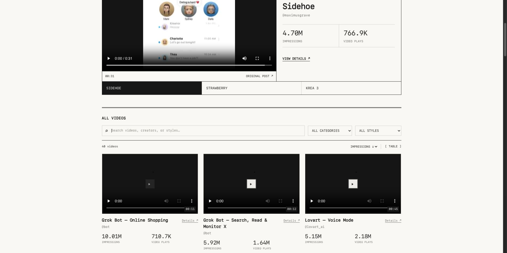

[](https://awesome.re)
[](#table-of-contents)
[](LICENSE)

> A visual collection of launch videos worth studying — with playable MP4s, performance data, and copyable prompts to clone them 1:1 for your product with AI.

For founders, designers, and builders making their next product launch. Browse a style, watch a reference, then copy the prompt and make it yours.

**Every entry includes a preview, the video file, a remake prompt, and credit to the original creator.** The [live site](https://serenatan.org/launchvideo/) plays videos directly in the cards; all 42 compressed reference files are also included in [videos/](videos/).

Inspired by the visual + copyable-prompt format of [Awesome NotebookLM Templates](https://github.com/serenakeyitan/awesome-notebookLM-prompts).

## Table of Contents

### [A. Device & UI Transformations](#device-ui-transformations)

- [Grok Bot — Online Shopping](#grok-bot-online-shopping)
- [Grok Bot — Search, Read & Monitor X](#grok-bot-search-read-monitor-x)
- [Poke — iMessage AI Assistant](#poke-imessage-ai-assistant)
- [Grok Bot — Action Button](#grok-bot-action-button)
- [Grok Bot — Vault](#grok-bot-vault)
- [Cursor — Computer Use](#cursor-computer-use)
- [Allo — Grok Bot Gets a Phone](#allo-grok-bot-gets-a-phone)
- [Notion — iPhone Duo](#notion-iphone-duo)
- [Readwise 2.0](#readwise-2-0)
- [Go-lo — Live Scores](#go-lo-live-scores)
- [Manus — Websites to Desktop Apps](#manus-websites-to-desktop-apps)

### [B. Clean UI, Data & Graphics](#clean-ui-data-graphics)

- [Notion AI — Agents & More](#notion-ai-agents-more)
- [Cursor SDK — run.steer()](#cursor-sdk-run-steer)
- [Vercel — Run Your Backend](#vercel-run-your-backend)
- [BELL — Personal Assistant Stack](#bell-personal-assistant-stack)
- [Coinbase — Over / Under](#coinbase-over-under)
- [Cursor — /visualize](#cursor-visualize)
- [Coinbase — Crypto Paychecks](#coinbase-crypto-paychecks)
- [Shipper — Build Bots with AI](#shipper-build-bots-with-ai)

### [C. Pastel UI & Cursor Demos](#pastel-ui-cursor-demos)

- [Lovart — Voice Mode](#lovart-voice-mode)
- [Sidehoe](#sidehoe)
- [Krea 3](#krea-3)
- [Strawberry 1.0](#strawberry-1-0)
- [Actify AI](#actify-ai)
- [CrowdReply — Citation Outreach](#crowdreply-citation-outreach)
- [Replit AI SDR](#replit-ai-sdr)
- [Tavus PAL](#tavus-pal)

### [D. Typography & Abstract Motion](#typography-abstract-motion)

- [AISC — Out of Stealth](#aisc-out-of-stealth)
- [TasteSkill v2](#tasteskill-v2)
- [Hermes — Profile Builder](#hermes-profile-builder)
- [Eleven Realtime](#eleven-realtime)

### [E. Dark, Gradient & Mixed Media](#dark-gradient-mixed-media)

- [Synthesia — Syren](#synthesia-syren)
- [Vida — Desktop Agent](#vida-desktop-agent)
- [Arcads — Mark](#arcads-mark)
- [Cash App — Weekly Bitcoin Rewards](#cash-app-weekly-bitcoin-rewards)
- [Kombai 2.0](#kombai-2-0)
- [Instinct](#instinct)
- [Lightreel](#lightreel)
- [Riverside — Agentic Editor](#riverside-agentic-editor)
- [Linear — Mobile Coding Sessions](#linear-mobile-coding-sessions)
- [Readwise for OpenClaw](#readwise-for-openclaw)
- [Studiyo — Grok Bot Widget](#studiyo-grok-bot-widget)

---

<a id="device-ui-transformations"></a>

## A. Device & UI Transformations

Phones, floating windows, camera moves, and interfaces that change shape.

<a id="grok-bot-online-shopping"></a>

### Grok Bot — Online Shopping

[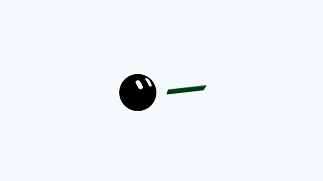](https://serenatan.org/launchvideo/assets/34.mp4)

**0:11 · 16:9 · 10.01M impressions · 710.7K plays**

[▶ Watch video](https://serenatan.org/launchvideo/assets/34.mp4) · [MP4 file](videos/grok-bot-online-shopping.mp4) · [Browse with stats](https://serenatan.org/launchvideo/#video-34)

A black circular mascot and one green payment-card graphic sit on a white canvas. Large captions tell one shopping feature in about eleven seconds using flat 2D shapes.

```text
clone this video 1:1 for my product
https://x.com/bot/status/2093419921007108385
```

*Source: [@bot](https://x.com/bot/status/2093419921007108385) · 2026-08-28*

<details>
<summary>Metadata & stats</summary>

| Metadata | Value |
| --- | --- |
| Posting account | @bot |
| Post date | 2026-08-28 |
| Stats snapshot (PT) | 2026-10-28 |
| Post impressions | 10,012,098 |
| Video plays | 710,732 |
| Likes | 10,120 |
| Bookmarks | 2,822 |
| Reposts | 971 |
| Replies | 703 |
| Quotes | 654 |
| Account followers | 478,073 |
| Original duration | 0:11 |
| Included file | 0:11 — full clip |
| Aspect ratio | 16:9 |
| Reference resolution | 960 × 540 |
| Audio track | None |

</details>

---

<a id="grok-bot-search-read-monitor-x"></a>

### Grok Bot — Search, Read & Monitor X

[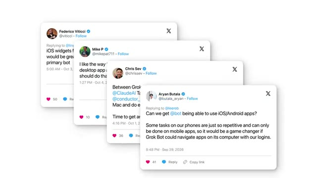](https://serenatan.org/launchvideo/assets/35.mp4)

**0:12 · 16:9 · 5.92M impressions · 1.64M plays**

[▶ Watch video](https://serenatan.org/launchvideo/assets/35.mp4) · [MP4 file](videos/grok-bot-search-read-monitor-x.mp4) · [Browse with stats](https://serenatan.org/launchvideo/#video-35)

A blue question bubble opens into three tweet cards arranged as a fan. An answer bubble and an orange keyword highlight complete a compact search-and-summary story.

```text
clone this video 1:1 for my product
https://x.com/bot/status/2107949161878606089
```

*Source: [@bot](https://x.com/bot/status/2107949161878606089) · 2026-10-07*

<details>
<summary>Metadata & stats</summary>

| Metadata | Value |
| --- | --- |
| Posting account | @bot |
| Post date | 2026-10-07 |
| Stats snapshot (PT) | 2026-10-28 |
| Post impressions | 5,924,871 |
| Video plays | 1,641,145 |
| Likes | 14,953 |
| Bookmarks | 4,790 |
| Reposts | 1,234 |
| Replies | 1,865 |
| Quotes | 1,162 |
| Account followers | 478,073 |
| Original duration | 0:12 |
| Included file | 0:12 — full clip |
| Aspect ratio | 16:9 |
| Reference resolution | 960 × 540 |
| Audio track | Present |

</details>

---

<a id="poke-imessage-ai-assistant"></a>

### Poke — iMessage AI Assistant

[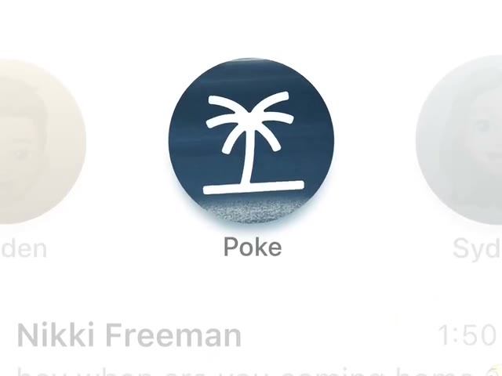](https://serenatan.org/launchvideo/assets/32.mp4)

**0:43 · 4:3 · 5.04M impressions · 563.0K plays**

[▶ Watch video](https://serenatan.org/launchvideo/assets/32.mp4) · [MP4 file](videos/poke-imessage-ai-assistant.mp4) · [Browse with stats](https://serenatan.org/launchvideo/#video-32)

Pan and zoom through an iMessage inbox, chat bubbles, maps and calendar cards. Memoji, rising feature cards and a closing app-icon grid create a product story without live-action scenes.

```text
clone this video 1:1 for my product
https://x.com/interaction/status/2062575428213285352
```

*Source: [@interaction](https://x.com/interaction/status/2062575428213285352) · 2026-06-04*

<details>
<summary>Metadata & stats</summary>

| Metadata | Value |
| --- | --- |
| Posting account | @interaction |
| Post date | 2026-06-04 |
| Stats snapshot (PT) | 2026-10-28 |
| Post impressions | 5,041,332 |
| Video plays | 562,985 |
| Likes | 5,488 |
| Bookmarks | 3,077 |
| Reposts | 235 |
| Replies | 435 |
| Quotes | 442 |
| Account followers | 26,043 |
| Original duration | 0:43 |
| Included file | 0:43 — full clip |
| Aspect ratio | 4:3 |
| Reference resolution | 640 × 480 |
| Audio track | Present |

</details>

---

<a id="grok-bot-action-button"></a>

### Grok Bot — Action Button

[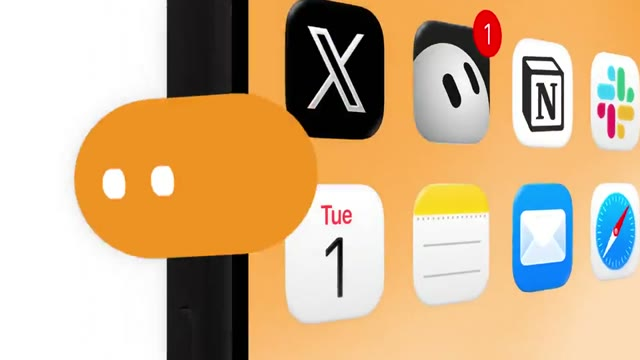](https://serenatan.org/launchvideo/assets/27.mp4)

**0:13 · 16:9 · 2.85M impressions · 904.9K plays**

[▶ Watch video](https://serenatan.org/launchvideo/assets/27.mp4) · [MP4 file](videos/grok-bot-action-button.mp4) · [Browse with stats](https://serenatan.org/launchvideo/#video-27)

A cursor selects an app icon on a stylized iPhone; the icon flies into the Action Button with a ripple. Camera pans and an expanding Dynamic Island turn device interactions into a story, followed by kinetic type and a logo reveal.

```text
clone this video 1:1 for my product
https://x.com/bot/status/2112252507762368684
```

*Source: [@bot](https://x.com/bot/status/2112252507762368684) · 2026-10-19*

<details>
<summary>Metadata & stats</summary>

| Metadata | Value |
| --- | --- |
| Posting account | @bot |
| Post date | 2026-10-19 |
| Stats snapshot (PT) | 2026-10-28 |
| Post impressions | 2,849,872 |
| Video plays | 904,920 |
| Likes | 17,483 |
| Bookmarks | 4,268 |
| Reposts | 1,111 |
| Replies | 2,347 |
| Quotes | 847 |
| Account followers | 478,073 |
| Original duration | 0:13 |
| Included file | 0:13 — full clip |
| Aspect ratio | 16:9 |
| Reference resolution | 960 × 540 |
| Audio track | Present |

</details>

---

<a id="grok-bot-vault"></a>

### Grok Bot — Vault

[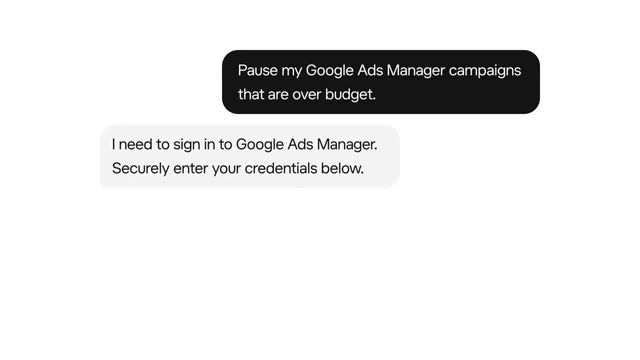](https://serenatan.org/launchvideo/assets/36.mp4)

**0:19 · 16:9 · 2.14M impressions · 687.3K plays**

[▶ Watch video](https://serenatan.org/launchvideo/assets/36.mp4) · [MP4 file](videos/grok-bot-vault.mp4) · [Browse with stats](https://serenatan.org/launchvideo/#video-36)

Login forms, password fields and a vault settings screen become clean UI cards. Orange and green full-screen gradients separate the scenes and keep the hierarchy clear.

```text
clone this video 1:1 for my product
https://x.com/bot/status/2113717946019397910
```

*Source: [@bot](https://x.com/bot/status/2113717946019397910) · 2026-10-23*

<details>
<summary>Metadata & stats</summary>

| Metadata | Value |
| --- | --- |
| Posting account | @bot |
| Post date | 2026-10-23 |
| Stats snapshot (PT) | 2026-10-28 |
| Post impressions | 2,139,786 |
| Video plays | 687,296 |
| Likes | 9,172 |
| Bookmarks | 2,214 |
| Reposts | 678 |
| Replies | 1,541 |
| Quotes | 539 |
| Account followers | 478,073 |
| Original duration | 0:19 |
| Included file | 0:19 — full clip |
| Aspect ratio | 16:9 |
| Reference resolution | 960 × 540 |
| Audio track | None |

</details>

---

<a id="cursor-computer-use"></a>

### Cursor — Computer Use

[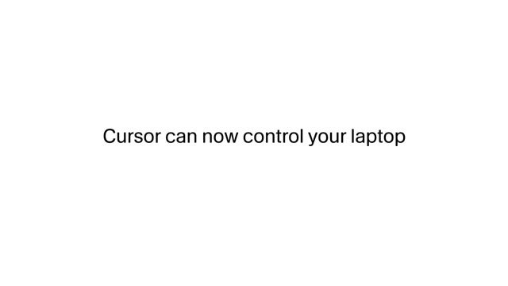](https://serenatan.org/launchvideo/assets/30.mp4)

**0:21 · 16:9 · 412.2K impressions · 164.7K plays**

[▶ Watch video](https://serenatan.org/launchvideo/assets/30.mp4) · [MP4 file](videos/cursor-computer-use.mp4) · [Browse with stats](https://serenatan.org/launchvideo/#video-30)

White title frames introduce computer use, followed by an orange-gradient product scene. A Cursor window and iPhone simulator sit side by side as the cursor demonstrates the workflow, ending on the cube logo.

```text
clone this video 1:1 for my product
https://x.com/cursor_ai/status/2113661506634305834
```

*Source: [@cursor_ai](https://x.com/cursor_ai/status/2113661506634305834) · 2026-10-23*

<details>
<summary>Metadata & stats</summary>

| Metadata | Value |
| --- | --- |
| Posting account | @cursor_ai |
| Post date | 2026-10-23 |
| Stats snapshot (PT) | 2026-10-28 |
| Post impressions | 412,246 |
| Video plays | 164,700 |
| Likes | 6,420 |
| Bookmarks | 1,334 |
| Reposts | 469 |
| Replies | 532 |
| Quotes | 441 |
| Account followers | 494,611 |
| Original duration | 0:21 |
| Included file | 0:21 — full clip |
| Aspect ratio | 16:9 |
| Reference resolution | 960 × 540 |
| Audio track | Present |

</details>

---

<a id="allo-grok-bot-gets-a-phone"></a>

### Allo — Grok Bot Gets a Phone

[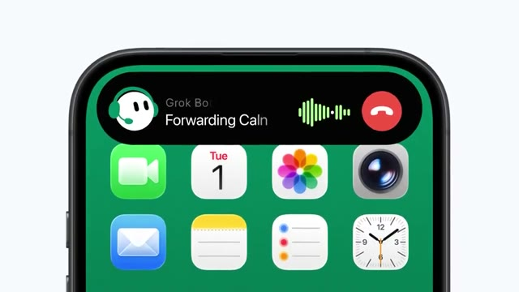](https://serenatan.org/launchvideo/assets/48.mp4)

**0:20 · 16:9 · 172.4K impressions · — plays**

[▶ Watch video](https://serenatan.org/launchvideo/assets/48.mp4) · [MP4 file](videos/allo-grok-bot-gets-a-phone.mp4) · [Browse with stats](https://serenatan.org/launchvideo/#video-48)

A black circular mascot gains a green headset, then moves into an iPhone call interface on a pale background. Large captions connect answering calls, preparing callbacks and chat bubbles, before a dark green Allo logo and integration reveal.

```text
clone this video 1:1 for my product
https://x.com/allophonesystem/status/2115793573589258279
```

*Source: [@allophonesystem](https://x.com/allophonesystem/status/2115793573589258279) · 2026-10-29*

<details>
<summary>Metadata & stats</summary>

| Metadata | Value |
| --- | --- |
| Posting account | @allophonesystem |
| Post date | 2026-10-29 |
| Stats snapshot (PT) | 2026-10-29 |
| Post impressions | 172,418 |
| Video plays | — |
| Likes | 1,237 |
| Bookmarks | 764 |
| Reposts | 74 |
| Replies | 93 |
| Quotes | 29 |
| Account followers | 371 |
| Original duration | 0:20 |
| Included file | 0:20 — full clip |
| Aspect ratio | 16:9 |
| Reference resolution | 960 × 540 |
| Audio track | Present |

</details>

---

<a id="notion-iphone-duo"></a>

### Notion — iPhone Duo

[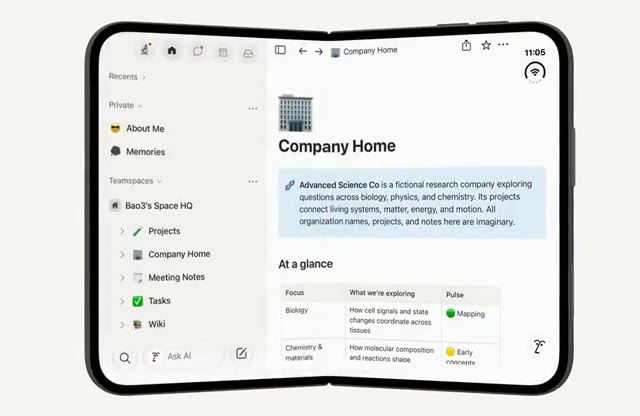](https://serenatan.org/launchvideo/assets/33.mp4)

**0:09 · 1.54:1 · 123.4K impressions · 48.2K plays**

[▶ Watch video](https://serenatan.org/launchvideo/assets/33.mp4) · [MP4 file](videos/notion-iphone-duo.mp4) · [Browse with stats](https://serenatan.org/launchvideo/#video-33)

A folding phone opens into a wider display while the interface rearranges to match. Keep the short film focused on one device transformation, then add scrolling and keyboard interactions.

```text
clone this video 1:1 for my product
https://x.com/NotionHQ/status/2113694972339986860
```

*Source: [@NotionHQ](https://x.com/NotionHQ/status/2113694972339986860) · 2026-10-23*

<details>
<summary>Metadata & stats</summary>

| Metadata | Value |
| --- | --- |
| Posting account | @NotionHQ |
| Post date | 2026-10-23 |
| Stats snapshot (PT) | 2026-10-28 |
| Post impressions | 123,361 |
| Video plays | 48,214 |
| Likes | 2,060 |
| Bookmarks | 180 |
| Reposts | 88 |
| Replies | 60 |
| Quotes | 28 |
| Account followers | 534,245 |
| Original duration | 0:09 |
| Included file | 0:09 — full clip |
| Aspect ratio | 1.54:1 |
| Reference resolution | 832 × 540 |
| Audio track | None |

</details>

---

<a id="readwise-2-0"></a>

### Readwise 2.0

[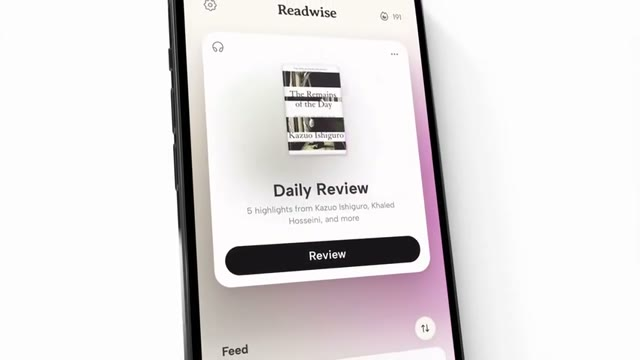](https://serenatan.org/launchvideo/assets/28.mp4)

**0:35 excerpt of 1:00 · 16:9 · 70.1K impressions · 15.3K plays**

[▶ Watch video](https://serenatan.org/launchvideo/assets/28.mp4) · [MP4 file](videos/readwise-2-0.mp4) · [Browse with stats](https://serenatan.org/launchvideo/#video-28)

Floating, tilted phones on white alternate with full-screen orange gradients. Camera pans and close-ups connect reading, chat and highlighting interfaces; large captions punctuate the sequence.

```text
clone this video 1:1 for my product
https://x.com/readwise/status/2079973992077902283
```

*Source: [@readwise](https://x.com/readwise/status/2079973992077902283) · 2026-07-22*

<details>
<summary>Metadata & stats</summary>

| Metadata | Value |
| --- | --- |
| Posting account | @readwise |
| Post date | 2026-07-22 |
| Stats snapshot (PT) | 2026-10-28 |
| Post impressions | 70,081 |
| Video plays | 15,321 |
| Likes | 350 |
| Bookmarks | 121 |
| Reposts | 36 |
| Replies | 42 |
| Quotes | 26 |
| Account followers | 211,948 |
| Original duration | 1:00 |
| Included file | 0:35 — excerpt |
| Aspect ratio | 16:9 |
| Reference resolution | 854 × 480 |
| Audio track | Present |

</details>

---

<a id="go-lo-live-scores"></a>

### Go-lo — Live Scores

[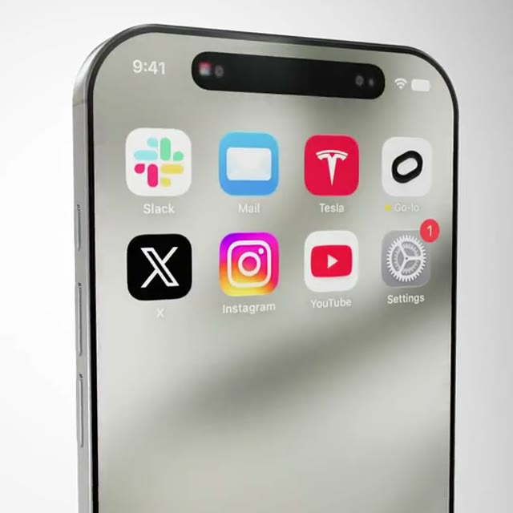](https://serenatan.org/launchvideo/assets/29.mp4)

**0:10 · 1:1 · 41.3K impressions · 273 plays**

[▶ Watch video](https://serenatan.org/launchvideo/assets/29.mp4) · [MP4 file](videos/go-lo-live-scores.mp4) · [Browse with stats](https://serenatan.org/launchvideo/#video-29)

Move from an app screen to its home-screen icon, then down to a lock-screen live-score card. Device perspective and camera motion carry a single feature; the rendered phone may need more than flat UI animation to match.

```text
clone this video 1:1 for my product
https://x.com/golo_app/status/2087584902984155632
```

*Source: [@golo_app](https://x.com/golo_app/status/2087584902984155632) · 2026-08-12*

<details>
<summary>Metadata & stats</summary>

| Metadata | Value |
| --- | --- |
| Posting account | @golo_app |
| Post date | 2026-08-12 |
| Stats snapshot (PT) | 2026-10-28 |
| Post impressions | 41,268 |
| Video plays | 273 |
| Likes | 4 |
| Bookmarks | 2 |
| Reposts | 0 |
| Replies | 1 |
| Quotes | 1 |
| Account followers | 219 |
| Original duration | 0:10 |
| Included file | 0:10 — full clip |
| Aspect ratio | 1:1 |
| Reference resolution | 540 × 540 |
| Audio track | None |

</details>

---

<a id="manus-websites-to-desktop-apps"></a>

### Manus — Websites to Desktop Apps

[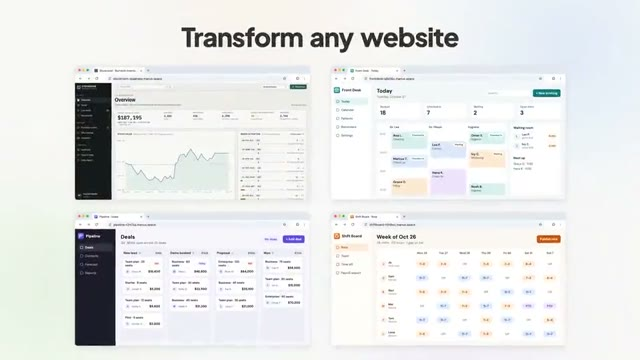](https://serenatan.org/launchvideo/assets/31.mp4)

**0:19 · 16:9 · 32.4K impressions · 11.8K plays**

[▶ Watch video](https://serenatan.org/launchvideo/assets/31.mp4) · [MP4 file](videos/manus-websites-to-desktop-apps.mp4) · [Browse with stats](https://serenatan.org/launchvideo/#video-31)

Click Install in a floating macOS window, then transform the window into a Dock icon. Spotlight, app switching and multiple windows make each click produce a visible system response.

```text
clone this video 1:1 for my product
https://x.com/ManusAI/status/2115110045977583909
```

*Source: [@ManusAI](https://x.com/ManusAI/status/2115110045977583909) · 2026-10-27*

<details>
<summary>Metadata & stats</summary>

| Metadata | Value |
| --- | --- |
| Posting account | @ManusAI |
| Post date | 2026-10-27 |
| Stats snapshot (PT) | 2026-10-28 |
| Post impressions | 32,399 |
| Video plays | 11,797 |
| Likes | 358 |
| Bookmarks | 124 |
| Reposts | 33 |
| Replies | 37 |
| Quotes | 10 |
| Account followers | 257,331 |
| Original duration | 0:19 |
| Included file | 0:19 — full clip |
| Aspect ratio | 16:9 |
| Reference resolution | 960 × 540 |
| Audio track | Present |

</details>

---

<a id="clean-ui-data-graphics"></a>

## B. Clean UI, Data & Graphics

One focal point per scene: charts, code cards, simple geometry, and useful product actions.

<a id="notion-ai-agents-more"></a>

### Notion AI — Agents & More

[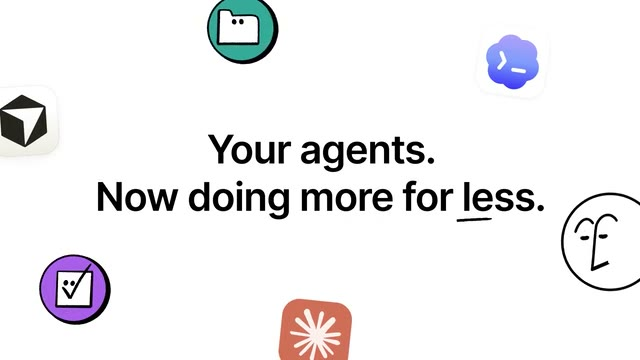](https://serenatan.org/launchvideo/assets/41.mp4)

**0:35 excerpt of 0:51 · 16:9 · 181.0K impressions · 61.6K plays**

[▶ Watch video](https://serenatan.org/launchvideo/assets/41.mp4) · [MP4 file](videos/notion-ai-agents-more.mp4) · [Browse with stats](https://serenatan.org/launchvideo/#video-41)

Muted peach and cream scenes give each feature its own full-screen color. Large titles, scrolling model names and cursor clicks create a compact sequence of AI updates.

```text
clone this video 1:1 for my product
https://x.com/NotionHQ/status/2112269722075242887
```

*Source: [@NotionHQ](https://x.com/NotionHQ/status/2112269722075242887) · 2026-10-19*

<details>
<summary>Metadata & stats</summary>

| Metadata | Value |
| --- | --- |
| Posting account | @NotionHQ |
| Post date | 2026-10-19 |
| Stats snapshot (PT) | 2026-10-28 |
| Post impressions | 181,002 |
| Video plays | 61,581 |
| Likes | 904 |
| Bookmarks | 408 |
| Reposts | 84 |
| Replies | 150 |
| Quotes | 87 |
| Account followers | 534,245 |
| Original duration | 0:51 |
| Included file | 0:35 — excerpt |
| Aspect ratio | 16:9 |
| Reference resolution | 640 × 360 |
| Audio track | Present |

</details>

---

<a id="cursor-sdk-run-steer"></a>

### Cursor SDK — run.steer()

[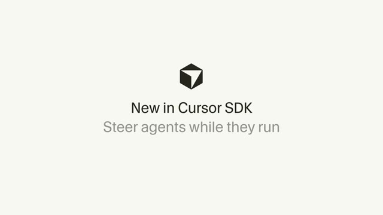](https://serenatan.org/launchvideo/assets/44.mp4)

**0:20 · 16:9 · 141.6K impressions · 54.1K plays**

[▶ Watch video](https://serenatan.org/launchvideo/assets/44.mp4) · [MP4 file](videos/cursor-sdk-run-steer.mp4) · [Browse with stats](https://serenatan.org/launchvideo/#video-44)

Type code into a white snippet card and highlight individual lines. A short, restrained sequence uses typography and code motion to explain the SDK method.

```text
clone this video 1:1 for my product
https://x.com/cursor_ai/status/2107141004482793827
```

*Source: [@cursor_ai](https://x.com/cursor_ai/status/2107141004482793827) · 2026-10-05*

<details>
<summary>Metadata & stats</summary>

| Metadata | Value |
| --- | --- |
| Posting account | @cursor_ai |
| Post date | 2026-10-05 |
| Stats snapshot (PT) | 2026-10-28 |
| Post impressions | 141,560 |
| Video plays | 54,078 |
| Likes | 1,339 |
| Bookmarks | 220 |
| Reposts | 84 |
| Replies | 146 |
| Quotes | 66 |
| Account followers | 494,611 |
| Original duration | 0:20 |
| Included file | 0:20 — full clip |
| Aspect ratio | 16:9 |
| Reference resolution | 854 × 480 |
| Audio track | None |

</details>

---

<a id="vercel-run-your-backend"></a>

### Vercel — Run Your Backend

[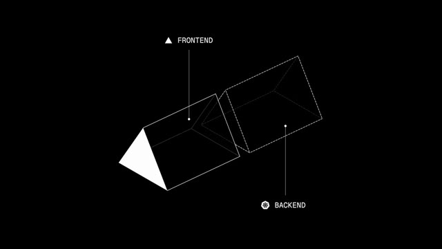](https://serenatan.org/launchvideo/assets/40.mp4)

**0:12 · 16:9 · 136.9K impressions · 49.1K plays**

[▶ Watch video](https://serenatan.org/launchvideo/assets/40.mp4) · [MP4 file](videos/vercel-run-your-backend.mp4) · [Browse with stats](https://serenatan.org/launchvideo/#video-40)

White wireframe triangles and cubes animate on a black canvas. Small frontend/backend labels keep the twelve-second geometric story precise and restrained.

```text
clone this video 1:1 for my product
https://x.com/vercel/status/2110786348131258456
```

*Source: [@vercel](https://x.com/vercel/status/2110786348131258456) · 2026-10-15*

<details>
<summary>Metadata & stats</summary>

| Metadata | Value |
| --- | --- |
| Posting account | @vercel |
| Post date | 2026-10-15 |
| Stats snapshot (PT) | 2026-10-28 |
| Post impressions | 136,877 |
| Video plays | 49,074 |
| Likes | 1,001 |
| Bookmarks | 273 |
| Reposts | 67 |
| Replies | 62 |
| Quotes | 43 |
| Account followers | 467,982 |
| Original duration | 0:12 |
| Included file | 0:12 — full clip |
| Aspect ratio | 16:9 |
| Reference resolution | 854 × 480 |
| Audio track | None |

</details>

---

<a id="bell-personal-assistant-stack"></a>

### BELL — Personal Assistant Stack

[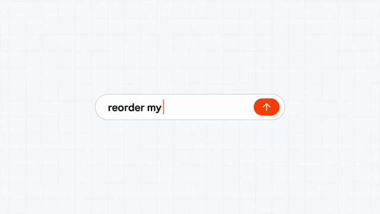](https://serenatan.org/launchvideo/assets/42.mp4)

**0:24 · 16:9 · 101.7K impressions · 31.5K plays**

[▶ Watch video](https://serenatan.org/launchvideo/assets/42.mp4) · [MP4 file](videos/bell-personal-assistant-stack.mp4) · [Browse with stats](https://serenatan.org/launchvideo/#video-42)

A white canvas and orange accents connect search, phone UI, two-dot eyes and a thinking state. Logo blocks spring into a stack, making the personal-assistant toolkit visible as a simple metaphor.

```text
clone this video 1:1 for my product
https://x.com/browserbase/status/2114777924335554605
```

*Source: [@browserbase](https://x.com/browserbase/status/2114777924335554605) · 2026-10-26*

<details>
<summary>Metadata & stats</summary>

| Metadata | Value |
| --- | --- |
| Posting account | @browserbase |
| Post date | 2026-10-26 |
| Stats snapshot (PT) | 2026-10-28 |
| Post impressions | 101,668 |
| Video plays | 31,498 |
| Likes | 553 |
| Bookmarks | 650 |
| Reposts | 36 |
| Replies | 40 |
| Quotes | 35 |
| Account followers | 22,145 |
| Original duration | 0:24 |
| Included file | 0:24 — full clip |
| Aspect ratio | 16:9 |
| Reference resolution | 854 × 480 |
| Audio track | Present |

</details>

---

<a id="coinbase-over-under"></a>

### Coinbase — Over / Under

[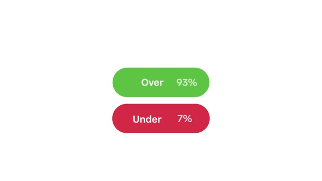](https://serenatan.org/launchvideo/assets/37.mp4)

**0:30 · 16:9 · 96.7K impressions · 12.6K plays**

[▶ Watch video](https://serenatan.org/launchvideo/assets/37.mp4) · [MP4 file](videos/coinbase-over-under.mp4) · [Browse with stats](https://serenatan.org/launchvideo/#video-37)

A blue logo frame gives way to green/red probability pills, a moving point on a chart and a countdown. Limit each scene to one focal element, then reveal a phone chart and return to the blue logo frame.

```text
clone this video 1:1 for my product
https://x.com/coinbase/status/2114148184285143349
```

*Source: [@coinbase](https://x.com/coinbase/status/2114148184285143349) · 2026-10-24*

<details>
<summary>Metadata & stats</summary>

| Metadata | Value |
| --- | --- |
| Posting account | @coinbase |
| Post date | 2026-10-24 |
| Stats snapshot (PT) | 2026-10-28 |
| Post impressions | 96,697 |
| Video plays | 12,557 |
| Likes | 263 |
| Bookmarks | 13 |
| Reposts | 29 |
| Replies | 85 |
| Quotes | 9 |
| Account followers | 7,192,388 |
| Original duration | 0:30 |
| Included file | 0:30 — full clip |
| Aspect ratio | 16:9 |
| Reference resolution | 960 × 540 |
| Audio track | Present |

</details>

---

<a id="cursor-visualize"></a>

### Cursor — /visualize

[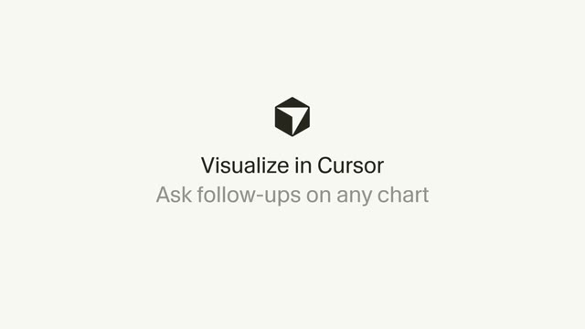](https://serenatan.org/launchvideo/assets/43.mp4)

**0:27 · 16:9 · 83.3K impressions · 28.9K plays**

[▶ Watch video](https://serenatan.org/launchvideo/assets/43.mp4) · [MP4 file](videos/cursor-visualize.mp4) · [Browse with stats](https://serenatan.org/launchvideo/#video-43)

Type /visualize into a minimal off-white chat interface. Draw a line chart, show hover/filter interactions, then turn a follow-up question into a growing bar chart.

```text
clone this video 1:1 for my product
https://x.com/cursor_ai/status/2108289748628566496
```

*Source: [@cursor_ai](https://x.com/cursor_ai/status/2108289748628566496) · 2026-10-08*

<details>
<summary>Metadata & stats</summary>

| Metadata | Value |
| --- | --- |
| Posting account | @cursor_ai |
| Post date | 2026-10-08 |
| Stats snapshot (PT) | 2026-10-28 |
| Post impressions | 83,261 |
| Video plays | 28,864 |
| Likes | 1,288 |
| Bookmarks | 207 |
| Reposts | 78 |
| Replies | 121 |
| Quotes | 19 |
| Account followers | 494,611 |
| Original duration | 0:27 |
| Included file | 0:27 — full clip |
| Aspect ratio | 16:9 |
| Reference resolution | 854 × 480 |
| Audio track | None |

</details>

---

<a id="coinbase-crypto-paychecks"></a>

### Coinbase — Crypto Paychecks

[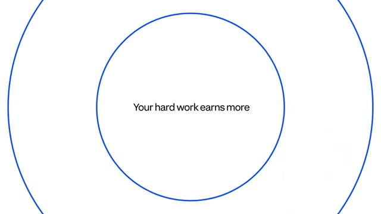](https://serenatan.org/launchvideo/assets/38.mp4)

**0:26 · 16:9 · 82.3K impressions · 7.8K plays**

[▶ Watch video](https://serenatan.org/launchvideo/assets/38.mp4) · [MP4 file](videos/coinbase-crypto-paychecks.mp4) · [Browse with stats](https://serenatan.org/launchvideo/#video-38)

Blue concentric circles become a row of colored dots, then a ring and an asset-allocation pie chart. Simple geometric morphs connect the story before the chart resolves inside a phone interface.

```text
clone this video 1:1 for my product
https://x.com/coinbase/status/2114718467610022208
```

*Source: [@coinbase](https://x.com/coinbase/status/2114718467610022208) · 2026-10-26*

<details>
<summary>Metadata & stats</summary>

| Metadata | Value |
| --- | --- |
| Posting account | @coinbase |
| Post date | 2026-10-26 |
| Stats snapshot (PT) | 2026-10-28 |
| Post impressions | 82,330 |
| Video plays | 7,786 |
| Likes | 325 |
| Bookmarks | 18 |
| Reposts | 36 |
| Replies | 60 |
| Quotes | 6 |
| Account followers | 7,192,388 |
| Original duration | 0:26 |
| Included file | 0:26 — full clip |
| Aspect ratio | 16:9 |
| Reference resolution | 960 × 540 |
| Audio track | Present |

</details>

---

<a id="shipper-build-bots-with-ai"></a>

### Shipper — Build Bots with AI

[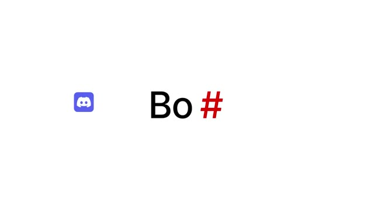](https://serenatan.org/launchvideo/assets/39.mp4)

**0:23 · 16:9 · 56.1K impressions · 14.7K plays**

[▶ Watch video](https://serenatan.org/launchvideo/assets/39.mp4) · [MP4 file](videos/shipper-build-bots-with-ai.mp4) · [Browse with stats](https://serenatan.org/launchvideo/#video-39)

Brand icons float above white UI cards with soft shadows. Large title frames and straightforward 2D transitions introduce bot-building across messaging platforms.

```text
clone this video 1:1 for my product
https://x.com/chddaniel/status/2048402359110557714
```

*Source: [@chddaniel](https://x.com/chddaniel/status/2048402359110557714) · 2026-04-26*

<details>
<summary>Metadata & stats</summary>

| Metadata | Value |
| --- | --- |
| Posting account | @chddaniel |
| Post date | 2026-04-26 |
| Stats snapshot (PT) | 2026-10-28 |
| Post impressions | 56,144 |
| Video plays | 14,744 |
| Likes | 422 |
| Bookmarks | 533 |
| Reposts | 13 |
| Replies | 56 |
| Quotes | 3 |
| Account followers | 28,520 |
| Original duration | 0:23 |
| Included file | 0:23 — full clip |
| Aspect ratio | 16:9 |
| Reference resolution | 854 × 480 |
| Audio track | Present |

</details>

---

<a id="pastel-ui-cursor-demos"></a>

## C. Pastel UI & Cursor Demos

Product stories driven by clear interfaces, oversized cursors, and quick visual payoffs.

<a id="lovart-voice-mode"></a>

### Lovart — Voice Mode

[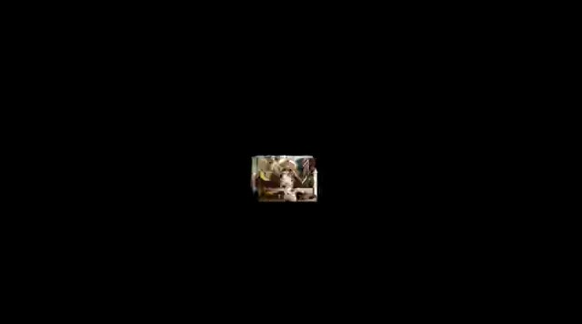](https://serenatan.org/launchvideo/assets/02.mp4)

**0:45 · 16:9 · 5.15M impressions · 2.18M plays**

[▶ Watch video](https://serenatan.org/launchvideo/assets/02.mp4) · [MP4 file](videos/lovart-voice-mode.mp4) · [Browse with stats](https://serenatan.org/launchvideo/#video-2)

Alternate black and white title frames with a clean voice-input interface. AI-generated image collages expand into a visual demonstration of voice edits.

```text
clone this video 1:1 for my product
https://x.com/lovart_ai/status/2033904987277774951
```

*Source: [@lovart_ai](https://x.com/lovart_ai/status/2033904987277774951) · 2026-03-17*

<details>
<summary>Metadata & stats</summary>

| Metadata | Value |
| --- | --- |
| Posting account | @lovart_ai |
| Post date | 2026-03-17 |
| Stats snapshot (PT) | 2026-10-27 |
| Post impressions | 5,150,093 |
| Video plays | 2,181,155 |
| Likes | 545 |
| Bookmarks | 163 |
| Reposts | 42 |
| Replies | 33 |
| Quotes | 7 |
| Account followers | 32,504 |
| Original duration | 0:45 |
| Included file | 0:45 — full clip |
| Aspect ratio | 16:9 |
| Reference resolution | 648 × 360 |
| Audio track | Present |

</details>

---

<a id="sidehoe"></a>

### Sidehoe

[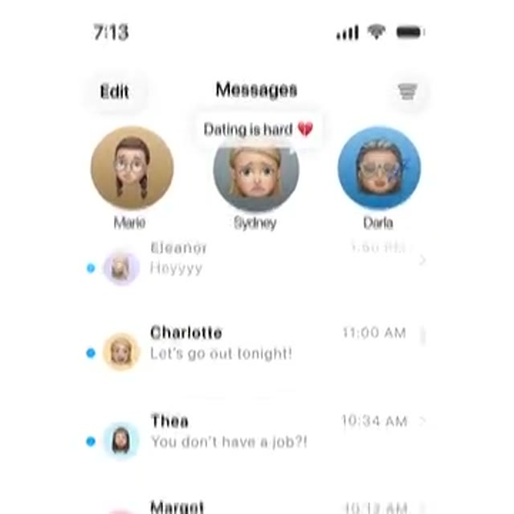](https://serenatan.org/launchvideo/assets/03.mp4)

**0:31 · 1:1 · 4.70M impressions · 766.9K plays**

[▶ Watch video](https://serenatan.org/launchvideo/assets/03.mp4) · [MP4 file](videos/sidehoe.mp4) · [Browse with stats](https://serenatan.org/launchvideo/#video-3)

Pink-purple gradients frame iMessage inboxes, chat bubbles, Memoji and floating app icons. An oversized cursor introduces a new feature every three to four seconds.

```text
clone this video 1:1 for my product
https://x.com/maximusgrave/status/2102800008982777902
```

*Source: [@maximusgrave](https://x.com/maximusgrave/status/2102800008982777902) · 2026-09-23*

<details>
<summary>Metadata & stats</summary>

| Metadata | Value |
| --- | --- |
| Posting account | @maximusgrave |
| Post date | 2026-09-23 |
| Stats snapshot (PT) | 2026-10-28 |
| Post impressions | 4,696,408 |
| Video plays | 766,906 |
| Likes | 11,440 |
| Bookmarks | 6,252 |
| Reposts | 446 |
| Replies | 684 |
| Quotes | 823 |
| Account followers | 2,788 |
| Original duration | 0:31 |
| Included file | 0:31 — full clip |
| Aspect ratio | 1:1 |
| Reference resolution | 360 × 360 |
| Audio track | Present |

</details>

---

<a id="krea-3"></a>

### Krea 3

[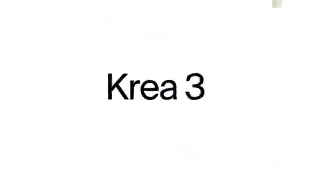](https://serenatan.org/launchvideo/assets/09.mp4)

**0:35 · 16:9 · 1.33M impressions · 103.5K plays**

[▶ Watch video](https://serenatan.org/launchvideo/assets/09.mp4) · [MP4 file](videos/krea-3.mp4) · [Browse with stats](https://serenatan.org/launchvideo/#video-9)

White and pale-gray scenes, a giant blue cursor and floating image cards. Pair “4x faster” charts and an Arena ranking with a precise-editing demonstration.

```text
clone this video 1:1 for my product
https://x.com/krea_ai/status/2112567020353102324
```

*Source: [@krea_ai](https://x.com/krea_ai/status/2112567020353102324) · 2026-10-20*

<details>
<summary>Metadata & stats</summary>

| Metadata | Value |
| --- | --- |
| Posting account | @krea_ai |
| Post date | 2026-10-20 |
| Stats snapshot (PT) | 2026-10-27 |
| Post impressions | 1,331,959 |
| Video plays | 103,493 |
| Likes | 1,631 |
| Bookmarks | 1,180 |
| Reposts | 192 |
| Replies | 122 |
| Quotes | 165 |
| Account followers | 122,869 |
| Original duration | 0:35 |
| Included file | 0:35 — full clip |
| Aspect ratio | 16:9 |
| Reference resolution | 640 × 360 |
| Audio track | Present |

</details>

---

<a id="strawberry-1-0"></a>

### Strawberry 1.0

[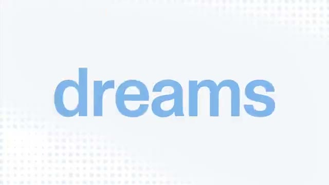](https://serenatan.org/launchvideo/assets/11.mp4)

**0:35 excerpt of 1:30 · 16:9 · 1.22M impressions · 172.3K plays**

[▶ Watch video](https://serenatan.org/launchvideo/assets/11.mp4) · [MP4 file](videos/strawberry-1-0.mp4) · [Browse with stats](https://serenatan.org/launchvideo/#video-11)

Cartoon characters and large kinetic titles lead into LinkedIn, calendar and meeting UI. Frequent zooms and quick scene changes create a dense product-story rhythm; the included file is a 35-second excerpt.

```text
clone this video 1:1 for my product
https://x.com/charles_maddock/status/2114659351470247986
```

*Source: [@charles_maddock](https://x.com/charles_maddock/status/2114659351470247986) · 2026-10-26*

<details>
<summary>Metadata & stats</summary>

| Metadata | Value |
| --- | --- |
| Posting account | @charles_maddock |
| Post date | 2026-10-26 |
| Stats snapshot (PT) | 2026-10-28 |
| Post impressions | 1,218,068 |
| Video plays | 172,278 |
| Likes | 4,366 |
| Bookmarks | 4,624 |
| Reposts | 280 |
| Replies | 333 |
| Quotes | 221 |
| Account followers | 9,928 |
| Original duration | 1:30 |
| Included file | 0:35 — excerpt |
| Aspect ratio | 16:9 |
| Reference resolution | 640 × 360 |
| Audio track | Present |

</details>

---

<a id="actify-ai"></a>

### Actify AI

[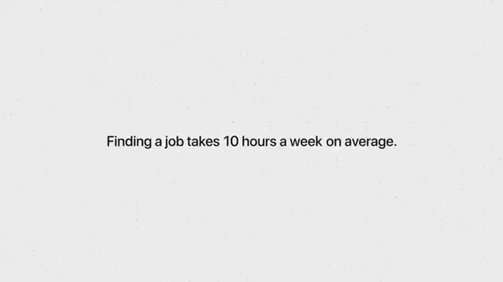](https://serenatan.org/launchvideo/assets/19.mp4)

**0:38 · 16:9 · 377.5K impressions · 1.2K plays**

[▶ Watch video](https://serenatan.org/launchvideo/assets/19.mp4) · [MP4 file](videos/actify-ai.mp4) · [Browse with stats](https://serenatan.org/launchvideo/#video-19)

Pale gray and purple full-screen frames introduce the job-search problem. Small type and an input UI carry a restrained demo, ending on the Actify logo.

```text
clone this video 1:1 for my product
https://x.com/ActifyAI/status/2080331695560274183
```

*Source: [@ActifyAI](https://x.com/ActifyAI/status/2080331695560274183) · 2026-07-23*

<details>
<summary>Metadata & stats</summary>

| Metadata | Value |
| --- | --- |
| Posting account | @ActifyAI |
| Post date | 2026-07-23 |
| Stats snapshot (PT) | 2026-10-27 |
| Post impressions | 377,523 |
| Video plays | 1,158 |
| Likes | 63 |
| Bookmarks | 10 |
| Reposts | 4 |
| Replies | 31 |
| Quotes | 2 |
| Account followers | 113 |
| Original duration | 0:38 |
| Included file | 0:38 — full clip |
| Aspect ratio | 16:9 |
| Reference resolution | 640 × 360 |
| Audio track | Present |

</details>

---

<a id="crowdreply-citation-outreach"></a>

### CrowdReply — Citation Outreach

[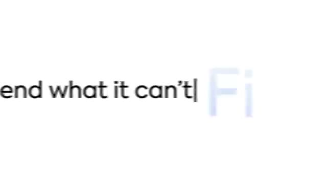](https://serenatan.org/launchvideo/assets/20.mp4)

**0:58 · 16:9 · 361.1K impressions · 68.6K plays**

[▶ Watch video](https://serenatan.org/launchvideo/assets/20.mp4) · [MP4 file](videos/crowdreply-citation-outreach.mp4) · [Browse with stats](https://serenatan.org/launchvideo/#video-20)

White UI with app icons, an “Opportunity Missed!” alert, tables and an oversized cursor. Conversational title frames lead into a workflow diagram and a soft-gradient close.

```text
clone this video 1:1 for my product
https://x.com/CrowdReply_io/status/2105312058451570973
```

*Source: [@CrowdReply_io](https://x.com/CrowdReply_io/status/2105312058451570973) · 2026-09-30*

<details>
<summary>Metadata & stats</summary>

| Metadata | Value |
| --- | --- |
| Posting account | @CrowdReply_io |
| Post date | 2026-09-30 |
| Stats snapshot (PT) | 2026-10-27 |
| Post impressions | 361,082 |
| Video plays | 68,580 |
| Likes | 699 |
| Bookmarks | 1,296 |
| Reposts | 41 |
| Replies | 60 |
| Quotes | 52 |
| Account followers | 17,039 |
| Original duration | 0:58 |
| Included file | 0:58 — full clip |
| Aspect ratio | 16:9 |
| Reference resolution | 640 × 360 |
| Audio track | Present |

</details>

---

<a id="replit-ai-sdr"></a>

### Replit AI SDR

[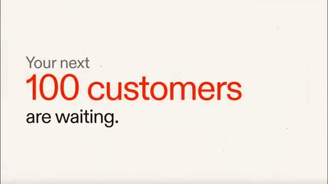](https://serenatan.org/launchvideo/assets/21.mp4)

**0:33 · 16:9 · 279.2K impressions · 61.7K plays**

[▶ Watch video](https://serenatan.org/launchvideo/assets/21.mp4) · [MP4 file](videos/replit-ai-sdr.mp4) · [Browse with stats](https://serenatan.org/launchvideo/#video-21)

Cream canvas and big red type introduce “Your next 100 customers are waiting.” Strike through manual, tedious and expensive; reveal tables and counters, then a logo close.

```text
clone this video 1:1 for my product
https://x.com/samuel_spitz/status/2041198900791714278
```

*Source: [@samuel_spitz](https://x.com/samuel_spitz/status/2041198900791714278) · 2026-04-06*

<details>
<summary>Metadata & stats</summary>

| Metadata | Value |
| --- | --- |
| Posting account | @samuel_spitz |
| Post date | 2026-04-06 |
| Stats snapshot (PT) | 2026-10-27 |
| Post impressions | 279,168 |
| Video plays | 61,696 |
| Likes | 770 |
| Bookmarks | 1,193 |
| Reposts | 26 |
| Replies | 48 |
| Quotes | 16 |
| Account followers | 34,278 |
| Original duration | 0:33 |
| Included file | 0:33 — full clip |
| Aspect ratio | 16:9 |
| Reference resolution | 642 × 360 |
| Audio track | Present |

</details>

---

<a id="tavus-pal"></a>

### Tavus PAL

[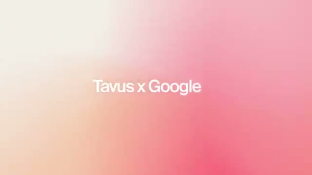](https://serenatan.org/launchvideo/assets/26.mp4)

**0:45 excerpt of 1:04 · 16:9 · 164.6K impressions · 27.6K plays**

[▶ Watch video](https://serenatan.org/launchvideo/assets/26.mp4) · [MP4 file](videos/tavus-pal.mp4) · [Browse with stats](https://serenatan.org/launchvideo/#video-26)

Cream and pink-orange gradients with slow-moving titles, calendar UI and meeting windows. Expanding rings link “Google Meet” to “Your PAL,” ending on Tavus branding.

```text
clone this video 1:1 for my product
https://x.com/tavus/status/2074894605125026072
```

*Source: [@tavus](https://x.com/tavus/status/2074894605125026072) · 2026-07-08*

<details>
<summary>Metadata & stats</summary>

| Metadata | Value |
| --- | --- |
| Posting account | @tavus |
| Post date | 2026-07-08 |
| Stats snapshot (PT) | 2026-10-27 |
| Post impressions | 164,598 |
| Video plays | 27,624 |
| Likes | 328 |
| Bookmarks | 237 |
| Reposts | 70 |
| Replies | 28 |
| Quotes | 12 |
| Account followers | 43,533 |
| Original duration | 1:04 |
| Included file | 0:45 — excerpt |
| Aspect ratio | 16:9 |
| Reference resolution | 640 × 360 |
| Audio track | Present |

</details>

---

<a id="typography-abstract-motion"></a>

## D. Typography & Abstract Motion

Kinetic type, counters, glowing outlines, rings, and waveform-led product stories.

<a id="aisc-out-of-stealth"></a>

### AISC — Out of Stealth

[](https://serenatan.org/launchvideo/assets/12.mp4)

**0:33 · 16:9 · 1.07M impressions · 42.5K plays**

[▶ Watch video](https://serenatan.org/launchvideo/assets/12.mp4) · [MP4 file](videos/aisc-out-of-stealth.mp4) · [Browse with stats](https://serenatan.org/launchvideo/#video-12)

Cream and dark frames alternate around a “Stop burning your budget” hook. Counters, social-post UI, comment bubbles and an icon grid build toward the logo.

```text
clone this video 1:1 for my product
https://x.com/aiscwork/status/2090862009008984574
```

*Source: [@aiscwork](https://x.com/aiscwork/status/2090862009008984574) · 2026-08-21*

<details>
<summary>Metadata & stats</summary>

| Metadata | Value |
| --- | --- |
| Posting account | @aiscwork |
| Post date | 2026-08-21 |
| Stats snapshot (PT) | 2026-10-27 |
| Post impressions | 1,066,893 |
| Video plays | 42,493 |
| Likes | 428 |
| Bookmarks | 218 |
| Reposts | 103 |
| Replies | 61 |
| Quotes | 16 |
| Account followers | 15,281 |
| Original duration | 0:33 |
| Included file | 0:33 — full clip |
| Aspect ratio | 16:9 |
| Reference resolution | 640 × 360 |
| Audio track | Present |

</details>

---

<a id="tasteskill-v2"></a>

### TasteSkill v2

[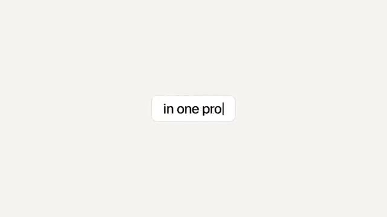](https://serenatan.org/launchvideo/assets/14.mp4)

**0:50 excerpt of 1:04 · 16:9 · 571.8K impressions · 163.4K plays**

[▶ Watch video](https://serenatan.org/launchvideo/assets/14.mp4) · [MP4 file](videos/tasteskill-v2.mp4) · [Browse with stats](https://serenatan.org/launchvideo/#video-14)

Minimal white frames with “Give your agent taste” and editorial image accents. Typography drives the story, closing on a black installation-command frame.

```text
clone this video 1:1 for my product
https://x.com/LexnLin/status/2110122106537050584
```

*Source: [@LexnLin](https://x.com/LexnLin/status/2110122106537050584) · 2026-10-13*

<details>
<summary>Metadata & stats</summary>

| Metadata | Value |
| --- | --- |
| Posting account | @LexnLin |
| Post date | 2026-10-13 |
| Stats snapshot (PT) | 2026-10-27 |
| Post impressions | 571,812 |
| Video plays | 163,398 |
| Likes | 4,709 |
| Bookmarks | 8,868 |
| Reposts | 235 |
| Replies | 103 |
| Quotes | 51 |
| Account followers | 32,498 |
| Original duration | 1:04 |
| Included file | 0:50 — excerpt |
| Aspect ratio | 16:9 |
| Reference resolution | 640 × 360 |
| Audio track | Present |

</details>

---

<a id="hermes-profile-builder"></a>

### Hermes — Profile Builder

[](https://serenatan.org/launchvideo/assets/15.mp4)

**0:47 · 1:1 · 546.6K impressions · 75.8K plays**

[▶ Watch video](https://serenatan.org/launchvideo/assets/15.mp4) · [MP4 file](videos/hermes-profile-builder.mp4) · [Browse with stats](https://serenatan.org/launchvideo/#video-15)

Black canvas with rough, glowing outlines and hand-drawn-looking cards. Identity → model provider → skills → MCPs → review, in a square composition.

```text
clone this video 1:1 for my product
https://x.com/NousResearch/status/2064760263224504719
```

*Source: [@NousResearch](https://x.com/NousResearch/status/2064760263224504719) · 2026-06-10*

<details>
<summary>Metadata & stats</summary>

| Metadata | Value |
| --- | --- |
| Posting account | @NousResearch |
| Post date | 2026-06-10 |
| Stats snapshot (PT) | 2026-10-27 |
| Post impressions | 546,620 |
| Video plays | 75,795 |
| Likes | 2,971 |
| Bookmarks | 1,396 |
| Reposts | 216 |
| Replies | 165 |
| Quotes | 68 |
| Account followers | 290,528 |
| Original duration | 0:47 |
| Included file | 0:47 — full clip |
| Aspect ratio | 1:1 |
| Reference resolution | 360 × 360 |
| Audio track | Present |

</details>

---

<a id="eleven-realtime"></a>

### Eleven Realtime

[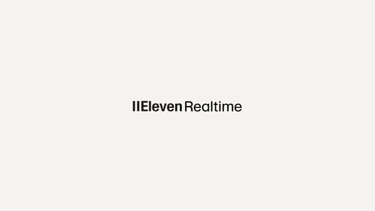](https://serenatan.org/launchvideo/assets/23.mp4)

**0:45 excerpt of 1:11 · 16:9 · 223.1K impressions · 74.4K plays**

[▶ Watch video](https://serenatan.org/launchvideo/assets/23.mp4) · [MP4 file](videos/eleven-realtime.mp4) · [Browse with stats](https://serenatan.org/launchvideo/#video-23)

Minimal black, white and gray; spheres, rings, waveforms and dialogue captions. Abstract motion and model-tier labels carry a voice-product story.

```text
clone this video 1:1 for my product
https://x.com/ElevenLabs/status/2112550782063247521
```

*Source: [@ElevenLabs](https://x.com/ElevenLabs/status/2112550782063247521) · 2026-10-20*

<details>
<summary>Metadata & stats</summary>

| Metadata | Value |
| --- | --- |
| Posting account | @ElevenLabs |
| Post date | 2026-10-20 |
| Stats snapshot (PT) | 2026-10-27 |
| Post impressions | 223,094 |
| Video plays | 74,421 |
| Likes | 2,509 |
| Bookmarks | 1,208 |
| Reposts | 190 |
| Replies | 137 |
| Quotes | 105 |
| Account followers | 208,922 |
| Original duration | 1:11 |
| Included file | 0:45 — excerpt |
| Aspect ratio | 16:9 |
| Reference resolution | 640 × 360 |
| Audio track | Present |

</details>

---

<a id="dark-gradient-mixed-media"></a>

## E. Dark, Gradient & Mixed Media

Dark interfaces, floating devices, image collage, and product demos mixed with people or generated footage.

<a id="synthesia-syren"></a>

### Synthesia — Syren

[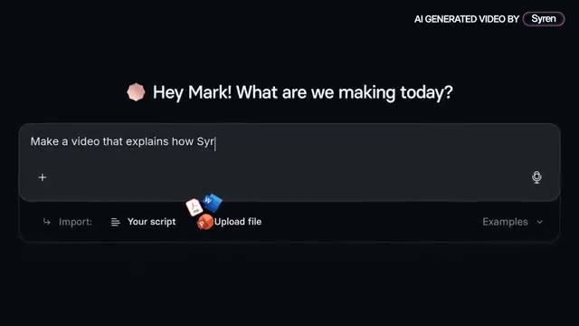](https://serenatan.org/launchvideo/assets/07.mp4)

**1:01 · 16:9 · 1.49M impressions · 46.4K plays**

[▶ Watch video](https://serenatan.org/launchvideo/assets/07.mp4) · [MP4 file](videos/synthesia-syren.mp4) · [Browse with stats](https://serenatan.org/launchvideo/#video-7)

The video is presented as an AI-generated Syren demo. Kinetic typography and brand cards mix with an AI presenter and a logo reveal.

```text
clone this video 1:1 for my product
https://x.com/vriparbelli/status/2107850981614489957
```

*Source: [@vriparbelli](https://x.com/vriparbelli/status/2107850981614489957) · 2026-10-07*

<details>
<summary>Metadata & stats</summary>

| Metadata | Value |
| --- | --- |
| Posting account | @vriparbelli |
| Post date | 2026-10-07 |
| Stats snapshot (PT) | 2026-10-27 |
| Post impressions | 1,489,041 |
| Video plays | 46,430 |
| Likes | 342 |
| Bookmarks | 385 |
| Reposts | 65 |
| Replies | 64 |
| Quotes | 107 |
| Account followers | 7,161 |
| Original duration | 1:01 |
| Included file | 1:01 — full clip |
| Aspect ratio | 16:9 |
| Reference resolution | 640 × 360 |
| Audio track | Present |

</details>

---

<a id="vida-desktop-agent"></a>

### Vida — Desktop Agent

[](https://serenatan.org/launchvideo/assets/10.mp4)

**1:02 · 16:9 · 1.29M impressions · 22.8K plays**

[▶ Watch video](https://serenatan.org/launchvideo/assets/10.mp4) · [MP4 file](videos/vida-desktop-agent.mp4) · [Browse with stats](https://serenatan.org/launchvideo/#video-10)

A short laptop shot introduces desktop windows, floating prompts and a large number counter. Caption-led storytelling moves from screen chaos to an agent doing useful work.

```text
clone this video 1:1 for my product
https://x.com/vida_agent/status/2069718855551955194
```

*Source: [@vida_agent](https://x.com/vida_agent/status/2069718855551955194) · 2026-06-24*

<details>
<summary>Metadata & stats</summary>

| Metadata | Value |
| --- | --- |
| Posting account | @vida_agent |
| Post date | 2026-06-24 |
| Stats snapshot (PT) | 2026-10-27 |
| Post impressions | 1,290,840 |
| Video plays | 22,779 |
| Likes | 865 |
| Bookmarks | 818 |
| Reposts | 117 |
| Replies | 128 |
| Quotes | 198 |
| Account followers | 714 |
| Original duration | 1:02 |
| Included file | 1:02 — full clip |
| Aspect ratio | 16:9 |
| Reference resolution | 640 × 360 |
| Audio track | Present |

</details>

---

<a id="arcads-mark"></a>

### Arcads — Mark

[](https://serenatan.org/launchvideo/assets/13.mp4)

**0:50 excerpt of 1:08 · 16:9 · 653.2K impressions · 78.6K plays**

[▶ Watch video](https://serenatan.org/launchvideo/assets/13.mp4) · [MP4 file](videos/arcads-mark.mp4) · [Browse with stats](https://serenatan.org/launchvideo/#video-13)

Dark, glowing interface cards: competitor scraping, suggestions and a mascot. Large cursor clicks and ad thumbnails combine a product reveal with a funding announcement.

```text
clone this video 1:1 for my product
https://x.com/arcads_ai/status/2084611105528115415
```

*Source: [@arcads_ai](https://x.com/arcads_ai/status/2084611105528115415) · 2026-08-04*

<details>
<summary>Metadata & stats</summary>

| Metadata | Value |
| --- | --- |
| Posting account | @arcads_ai |
| Post date | 2026-08-04 |
| Stats snapshot (PT) | 2026-10-27 |
| Post impressions | 653,216 |
| Video plays | 78,595 |
| Likes | 1,224 |
| Bookmarks | 1,762 |
| Reposts | 60 |
| Replies | 207 |
| Quotes | 96 |
| Account followers | 12,388 |
| Original duration | 1:08 |
| Included file | 0:50 — excerpt |
| Aspect ratio | 16:9 |
| Reference resolution | 640 × 360 |
| Audio track | Present |

</details>

---

<a id="cash-app-weekly-bitcoin-rewards"></a>

### Cash App — Weekly Bitcoin Rewards

[](https://serenatan.org/launchvideo/assets/45.mp4)

**0:17 · 1:1 · 506.0K impressions · 87.5K plays**

[▶ Watch video](https://serenatan.org/launchvideo/assets/45.mp4) · [MP4 file](videos/cash-app-weekly-bitcoin-rewards.mp4) · [Browse with stats](https://serenatan.org/launchvideo/#video-45)

A floating phone switches between an app launch screen, a toggle, a lock-screen notification and a reward result. A fluid multicolor gradient supplies atmosphere; much of the phone content resembles actual app footage.

```text
clone this video 1:1 for my product
https://x.com/CashApp/status/2103207687127466307
```

*Source: [@CashApp](https://x.com/CashApp/status/2103207687127466307) · 2026-09-24*

<details>
<summary>Metadata & stats</summary>

| Metadata | Value |
| --- | --- |
| Posting account | @CashApp |
| Post date | 2026-09-24 |
| Stats snapshot (PT) | 2026-10-28 |
| Post impressions | 505,968 |
| Video plays | 87,478 |
| Likes | 736 |
| Bookmarks | 172 |
| Reposts | 94 |
| Replies | 127 |
| Quotes | 28 |
| Account followers | 2,002,490 |
| Original duration | 0:17 |
| Included file | 0:17 — full clip |
| Aspect ratio | 1:1 |
| Reference resolution | 480 × 480 |
| Audio track | None |

</details>

---

<a id="kombai-2-0"></a>

### Kombai 2.0

[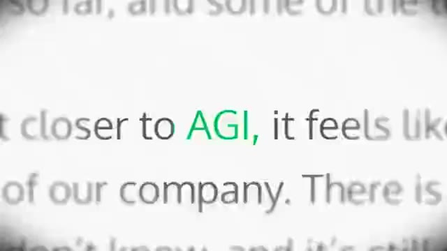](https://serenatan.org/launchvideo/assets/16.mp4)

**0:45 excerpt of 1:25 · 16:9 · 443.2K impressions · 51.1K plays**

[▶ Watch video](https://serenatan.org/launchvideo/assets/16.mp4) · [MP4 file](videos/kombai-2-0.mp4) · [Browse with stats](https://serenatan.org/launchvideo/#video-16)

A founder introduction gives way to web-design windows, terminal scenes and a bold “DOMINATE” frame. Finish with a green gradient and the AI design engineer proposition.

```text
clone this video 1:1 for my product
https://x.com/Dipanjan_Dey/status/2061825199247614316
```

*Source: [@Dipanjan_Dey](https://x.com/Dipanjan_Dey/status/2061825199247614316) · 2026-06-02*

<details>
<summary>Metadata & stats</summary>

| Metadata | Value |
| --- | --- |
| Posting account | @Dipanjan_Dey |
| Post date | 2026-06-02 |
| Stats snapshot (PT) | 2026-10-27 |
| Post impressions | 443,209 |
| Video plays | 51,109 |
| Likes | 407 |
| Bookmarks | 443 |
| Reposts | 33 |
| Replies | 97 |
| Quotes | 66 |
| Account followers | 1,058 |
| Original duration | 1:25 |
| Included file | 0:45 — excerpt |
| Aspect ratio | 16:9 |
| Reference resolution | 640 × 360 |
| Audio track | Present |

</details>

---

<a id="instinct"></a>

### Instinct

[](https://serenatan.org/launchvideo/assets/17.mp4)

**0:26 · 16:9 · 435.4K impressions · 140.7K plays**

[▶ Watch video](https://serenatan.org/launchvideo/assets/17.mp4) · [MP4 file](videos/instinct.mp4) · [Browse with stats](https://serenatan.org/launchvideo/#video-17)

Dark trading terminals sit over warm gradients. Notification cards deliver a specific market signal before a “Trade with superhuman” close.

```text
clone this video 1:1 for my product
https://x.com/instinct_xyz/status/2110439790961442825
```

*Source: [@instinct_xyz](https://x.com/instinct_xyz/status/2110439790961442825) · 2026-10-14*

<details>
<summary>Metadata & stats</summary>

| Metadata | Value |
| --- | --- |
| Posting account | @instinct_xyz |
| Post date | 2026-10-14 |
| Stats snapshot (PT) | 2026-10-27 |
| Post impressions | 435,354 |
| Video plays | 140,745 |
| Likes | 2,766 |
| Bookmarks | 3,945 |
| Reposts | 180 |
| Replies | 120 |
| Quotes | 74 |
| Account followers | 6,907 |
| Original duration | 0:26 |
| Included file | 0:26 — full clip |
| Aspect ratio | 16:9 |
| Reference resolution | 640 × 360 |
| Audio track | Present |

</details>

---

<a id="lightreel"></a>

### Lightreel

[](https://serenatan.org/launchvideo/assets/18.mp4)

**0:31 · 16:9 · 394.5K impressions · 67.1K plays**

[▶ Watch video](https://serenatan.org/launchvideo/assets/18.mp4) · [MP4 file](videos/lightreel.mp4) · [Browse with stats](https://serenatan.org/launchvideo/#video-18)

White, red and blue frames; TikTok cards, meme-like cutouts and big conversational captions. Fast collage pacing supports a creator-discovery demonstration.

```text
clone this video 1:1 for my product
https://x.com/Jibran_05/status/2033589137018917027
```

*Source: [@Jibran_05](https://x.com/Jibran_05/status/2033589137018917027) · 2026-03-16*

<details>
<summary>Metadata & stats</summary>

| Metadata | Value |
| --- | --- |
| Posting account | @Jibran_05 |
| Post date | 2026-03-16 |
| Stats snapshot (PT) | 2026-10-27 |
| Post impressions | 394,483 |
| Video plays | 67,145 |
| Likes | 1,861 |
| Bookmarks | 2,771 |
| Reposts | 151 |
| Replies | 190 |
| Quotes | 39 |
| Account followers | 11,359 |
| Original duration | 0:31 |
| Included file | 0:31 — full clip |
| Aspect ratio | 16:9 |
| Reference resolution | 640 × 360 |
| Audio track | Present |

</details>

---

<a id="riverside-agentic-editor"></a>

### Riverside — Agentic Editor

[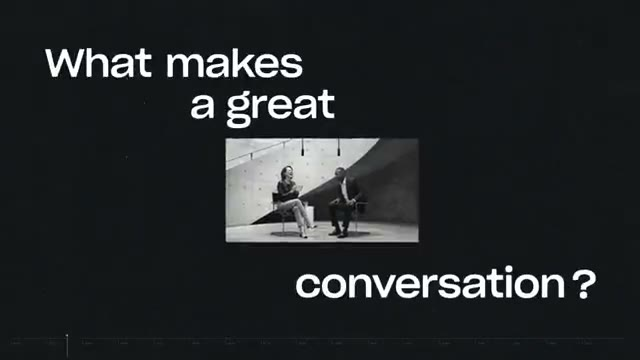](https://serenatan.org/launchvideo/assets/22.mp4)

**0:38 · 16:9 · 259.3K impressions · 13.0K plays**

[▶ Watch video](https://serenatan.org/launchvideo/assets/22.mp4) · [MP4 file](videos/riverside-agentic-editor.mp4) · [Browse with stats](https://serenatan.org/launchvideo/#video-22)

Dark title frames mix photo collage with an editing timeline. Later product-demo scenes include people in podcast footage.

```text
clone this video 1:1 for my product
https://x.com/RiversidedotFM/status/2077770308992258493
```

*Source: [@RiversidedotFM](https://x.com/RiversidedotFM/status/2077770308992258493) · 2026-07-16*

<details>
<summary>Metadata & stats</summary>

| Metadata | Value |
| --- | --- |
| Posting account | @RiversidedotFM |
| Post date | 2026-07-16 |
| Stats snapshot (PT) | 2026-10-27 |
| Post impressions | 259,271 |
| Video plays | 12,963 |
| Likes | 135 |
| Bookmarks | 105 |
| Reposts | 10 |
| Replies | 23 |
| Quotes | 9 |
| Account followers | 11,108 |
| Original duration | 0:38 |
| Included file | 0:38 — full clip |
| Aspect ratio | 16:9 |
| Reference resolution | 640 × 360 |
| Audio track | Present |

</details>

---

<a id="linear-mobile-coding-sessions"></a>

### Linear — Mobile Coding Sessions

[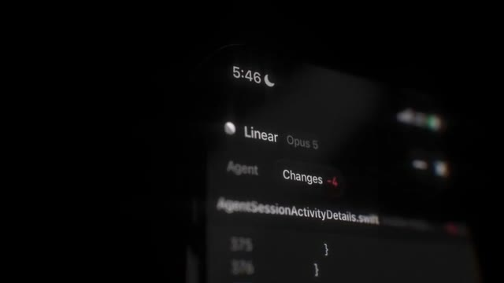](https://serenatan.org/launchvideo/assets/47.mp4)

**0:21 · 16:9 · 64.0K impressions · 13.5K plays**

[▶ Watch video](https://serenatan.org/launchvideo/assets/47.mp4) · [MP4 file](videos/linear-mobile-coding-sessions.mp4) · [Browse with stats](https://serenatan.org/launchvideo/#video-47)

A phone interface floats at an angle against black. Code diffs and a keyboard appear in sequence before the Linear logo; perspective supplies most of the atmosphere.

```text
clone this video 1:1 for my product
https://x.com/linear/status/2082856036977803595
```

*Source: [@linear](https://x.com/linear/status/2082856036977803595) · 2026-07-30*

<details>
<summary>Metadata & stats</summary>

| Metadata | Value |
| --- | --- |
| Posting account | @linear |
| Post date | 2026-07-30 |
| Stats snapshot (PT) | 2026-10-28 |
| Post impressions | 63,978 |
| Video plays | 13,463 |
| Likes | 309 |
| Bookmarks | 110 |
| Reposts | 9 |
| Replies | 13 |
| Quotes | 10 |
| Account followers | 115,210 |
| Original duration | 0:21 |
| Included file | 0:21 — full clip |
| Aspect ratio | 16:9 |
| Reference resolution | 854 × 480 |
| Audio track | Present |

</details>

---

<a id="readwise-for-openclaw"></a>

### Readwise for OpenClaw

[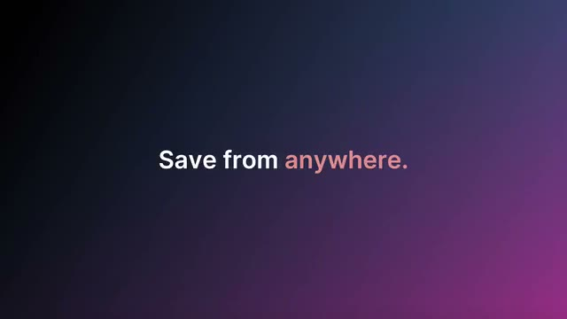](https://serenatan.org/launchvideo/assets/46.mp4)

**0:37 · 16:9 · 57.2K impressions · 15.9K plays**

[▶ Watch video](https://serenatan.org/launchvideo/assets/46.mp4) · [MP4 file](videos/readwise-for-openclaw.mp4) · [Browse with stats](https://serenatan.org/launchvideo/#video-46)

Deep purple and magenta gradients frame an iPhone conversation and large title statements. Alternate phone UI with typography, ending on a terminal command and logo; the source notes a brief tweet screenshot.

```text
clone this video 1:1 for my product
https://x.com/readwise/status/2037536421414653965
```

*Source: [@readwise](https://x.com/readwise/status/2037536421414653965) · 2026-03-27*

<details>
<summary>Metadata & stats</summary>

| Metadata | Value |
| --- | --- |
| Posting account | @readwise |
| Post date | 2026-03-27 |
| Stats snapshot (PT) | 2026-10-28 |
| Post impressions | 57,240 |
| Video plays | 15,925 |
| Likes | 395 |
| Bookmarks | 480 |
| Reposts | 31 |
| Replies | 23 |
| Quotes | 15 |
| Account followers | 211,948 |
| Original duration | 0:37 |
| Included file | 0:37 — full clip |
| Aspect ratio | 16:9 |
| Reference resolution | 640 × 360 |
| Audio track | Present |

</details>

---

<a id="studiyo-grok-bot-widget"></a>

### Studiyo — Grok Bot Widget

[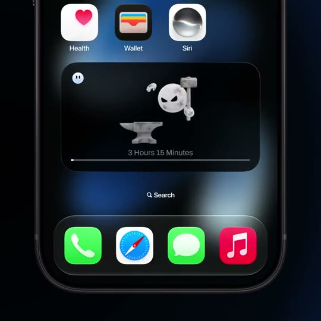](https://serenatan.org/launchvideo/assets/49.mp4)

**0:15 · 1:1 · 48.5K impressions · — plays**

[▶ Watch video](https://serenatan.org/launchvideo/assets/49.mp4) · [MP4 file](videos/studiyo-grok-bot-widget.mp4) · [Browse with stats](https://serenatan.org/launchvideo/#video-49)

An iPhone home-screen widget introduces a round mascot, then cycles through expressive agent characters on a dark interface. The widget switches from loading files to a task-progress view, where a small mascot hammers an anvil above a growing progress bar.

```text
clone this video 1:1 for my product
https://x.com/Studiyoco/status/2101329629701443613
```

*Source: [@Studiyoco](https://x.com/Studiyoco/status/2101329629701443613) · 2026-09-19*

<details>
<summary>Metadata & stats</summary>

| Metadata | Value |
| --- | --- |
| Posting account | @Studiyoco |
| Post date | 2026-09-19 |
| Stats snapshot (PT) | 2026-10-29 |
| Post impressions | 48,461 |
| Video plays | — |
| Likes | 455 |
| Bookmarks | 213 |
| Reposts | 19 |
| Replies | 25 |
| Quotes | 2 |
| Account followers | 3,739 |
| Original duration | 0:15 |
| Included file | 0:15 — full clip |
| Aspect ratio | 1:1 |
| Reference resolution | 540 × 540 |
| Audio track | None |

</details>

---

## How to use these prompts

1. Pick a video and copy its prompt, including the Twitter/X source link.
2. Paste it into your AI coding or video tool.
3. Add your product details and assets.

## Data & source notes

- Metrics are historical snapshots (Pacific time). Each entry records its own date; counts are not live. Unavailable counts appear as —.
- Impressions describe post exposure, not video plays. They do not establish organic reach or exclude paid promotion.
- Posting-account follower counts may describe a founder or employee rather than a company.
- Files are compressed references, up to 540p. Eight entries are excerpts; their original durations are shown. Stats describe the full source posts.
- Style notes are based on sampled frames and supplied metadata. Style categories are editorial judgments.
- Full metadata, original Chinese notes, source links, and prompts are in [data/videos.json](data/videos.json).

## Contributing

Suggestions are welcome! Open a PR with a public source post, a preview, a useful style breakdown, and a copyable remake prompt. Include a dated source for any stats, and label excerpts clearly. Add the entry to `data/videos.json`, then run:

```bash
python3 scripts/build_readme.py
```

## License & credits

Original curation, prompts, and repository code are [MIT licensed](LICENSE). Third-party videos, previews, product UI, logos, and branding remain with their respective owners; the MIT license does not grant rights to those assets. Every video links to its original post.
